# Beating ELO With Raw Match History: A Tennis Win-Probability Model

*Can a model predict who wins a tennis match better than a club's incumbent ELO rating system,
without ever being given the ELO number itself? Nine experiments — from a closed-form baseline to
an enriched GRU sequence model — say yes, and pin down exactly where ELO still earns its keep.*

## TL;DR

**The thesis question: can a model beat ELO without ever using the ELO number as a feature? Yes.**

- **Thesis result — Exp C, the ELO-free GRU (never sees ELO anywhere in its input):** trained
  purely on each player's raw match-history sequence (win/loss, set margin, rest days, razina,
  home-court share, opponent quality-at-the-time — no `EloBefore`/`EloAfter`, ever), it still beats
  the incumbent ELO rating system on every metric. **This is the thesis result the title refers
  to.**
- **Best overall — Exp C3, the enriched GRU (ELO-included):** the same architecture family, but
  deliberately fed point-in-time ELO (per-step `OpponentEloBefore` plus ELO at the prediction
  head). It is the strongest model built in this project by every point-estimate metric, and the
  one used for the learning-curve deep-dive below. Its −10.4% Brier improvement is **not** the
  ELO-free result — it's a *different, better-resourced* model that was deliberately allowed to see
  ELO. This is also the model exported for serving (see "Serving" below) — it was later deployed as
  a live feature in the club app this project's data comes from, precisely *because* it was allowed
  to use ELO and won on raw accuracy.

| Model | Uses ELO? | Brier ↓ | Accuracy ↑ | AUC ↑ |
|---|---|---|---|---|
| ELO baseline | — | 0.1771 | 75.18% | 82.10% |
| **Exp C — ELO-free GRU (thesis answer)** | ❌ | 0.1628 (−8.1%) | 76.21% (+1.03 pp) | 84.11% (+2.01 pp / +2.4% naive / +6.3% above-chance) |
| **Exp C3 — enriched GRU (best overall)** | ✅ | 0.1587 (−10.4%) | 76.44% (+1.26 pp) | 85.02% (+2.91 pp / +3.5% naive / +9.1% above-chance) |

Both results hold up not just on one test split but across 4 independent walk-forward time
periods (see Results below).


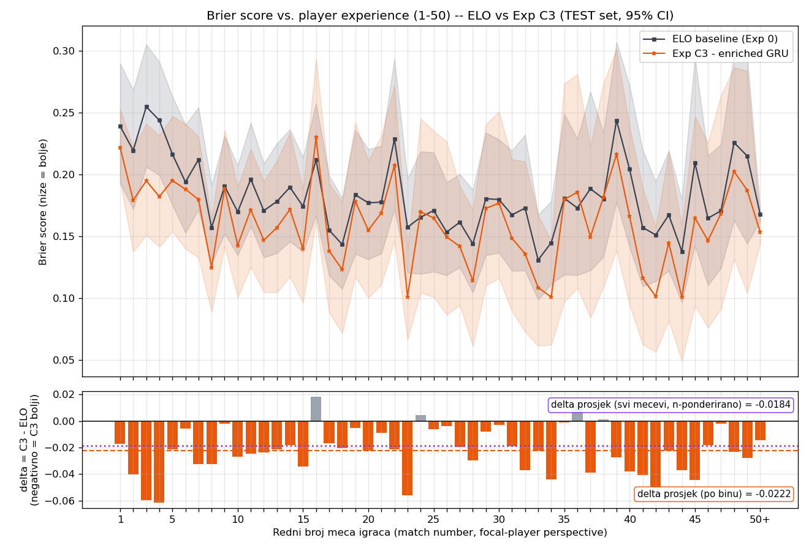

*These two charts (notebook 13) are about the **best-overall, ELO-included Exp C3 model**, not
the ELO-free thesis result above — they break accuracy and Brier score down by a player's own
match number at prediction time, ELO vs. Exp C3, with 95% confidence intervals and a per-bin
delta. See the Charts section below for the rest of the result plots (calibration, feature
importance, training curves, walk-forward folds).*

**Status: all 13 notebooks are complete** — the original 4-notebook pipeline (data exploration
through the Exp 0/A/B evaluation), eight follow-up notebooks (05–12) that stress-tested the
headline result with confidence intervals, walk-forward cross-validation, four additional model
variants (Exp A′/B′, C2, C3, C4), and a final five-model walk-forward pass that settles the
project's capstone conclusion, plus a 13th learning-curve deep-dive on the winning model. **A
serving/export pipeline for the winning model (Exp C3) is also included in this repo** — see
"Serving" below — and that model has since been deployed as a live feature in the private club app
this project's data comes from. The research documented here (notebooks, experiments, validation)
and the export pipeline that made deployment possible both live in this repo; the live club app
itself is a separate, private codebase and is not part of it.

This is a standalone research project — self-contained, with its own dependencies
(`requirements.txt` for the notebooks, `package.json` for the Node.js data-export scripts) and no
runtime dependency on any other codebase. It grew out of statistics work for a real recreational
tennis league's club-management app, but every notebook, script, and model here only ever reads
from the exported CSV/parquet files under `data/` — nothing here imports from, or depends on,
anything outside this repo.

## Problem

Predict the probability that player A beats player B in a recreational tennis league (Tenis Liga
Split), and specifically test whether a model can match or beat the incumbent ELO rating system
**without ever being given the ELO number at all**. ELO is the baseline to beat, not a feature to
casually include — the interesting question is what a model can recover about skill purely from
the win/loss graph and match context.

## Data

Singles matches (`SM`/`SF` leagues only) from a Croatian recreational tennis league, **~17,128
matches, 2017-05-01 to present (~9 years)**. Masters (`LigaTip='MA'`), doubles pairs
(`IgracPar=1`), and friendly matches (`LigaId IS NULL`) are excluded. Data is exported from a
read-only SQL Server database via a standalone Node.js script (`scripts/export_data.mjs`) —
see `data/README.md` for the exporter, full column schema, and the empirical data-quality findings
(e.g. the birth-date column turned out to be 100% NULL in production; birth *year* was used
instead). **The raw export and all trained model artifacts are gitignored** — they contain real
player IDs and are never committed (see "Never Commit" below — this repo's `.gitignore` and the
excluded data files are the actual enforced privacy boundary here, not just a stated intention).

Duplicate-and-flip symmetric expansion turns the 17,128 matches into **34,256 rows** (2 per match:
one row per player's perspective, with features expressed as `this_player − opponent` diffs).
Time-based 80/20 split by match date: **train = 27,404 rows / 13,702 matches (2017-05-08 to
2025-01-18)**, **test = 6,852 rows / 3,426 matches (2025-01-19 to 2026-07-08)**.

Experiment C4 additionally consumes a small side table, `data/trenutci_scores.csv` (gitignored
— PII), scoring free-text `Trenutci` player self-descriptions on a 1–10 skill scale via a
concurrent Gemini pass — 671 of 779 in-scope players scored (~86% coverage); see
`11_enriched_gru_text.ipynb` Step 8b for the join methodology and missing-value handling.

## Methodology

### Point-in-time feature engineering (leakage discipline)

Every feature is computed strictly as of the moment *before* the match it predicts, using SQL
window functions (`ROW_NUMBER`, `LAG`, rolling `AVG`/`SUM` with `ROWS BETWEEN ... PRECEDING`) and
the equivalent pandas `groupby`/`shift`/`cumcount` patterns in the notebooks. This mirrors a real
production bug already caught once in this codebase (`forma-rang.php`'s `OpponentOfficialMatches`
incident — an all-time count was accidentally used instead of a point-in-time one) and the same
discipline is re-applied and re-audited in every one of the thirteen notebooks here, including two
mechanisms that look like leakage risks but aren't and are explicitly documented as such: (1)
season-roster/"pyramid size" features (fixed at season start, not derived from match outcomes),
and (2) a debut-razina feature (an admin placement decision made before any ELO exists for that
player).

Features are tagged **ELO / ELO-derived** (excluded from ELO-free experiments), **ELO-substitute**
(opponent-quality signal built only from the win/loss graph, league-tier structure, or pre-ELO
signup data — never from `EloBefore`/`EloAfter`), or **neutral context** (rest days, age,
home-court, category encodings). This tagging is what makes the ELO-free experiments a fair fight
rather than a straw man.

### Time-based split, never random

Match outcomes depend on past ELO, past H2H, and past form — all derived from historical match
order. A random split would leak future-derived information into training via the ELO number
itself. All splits here are chronological; the first 80% of matches (by date) train, the last 20%
test, with a `Split` marker also carried consistently across every follow-up notebook and every
walk-forward fold.

### Duplicate-and-flip symmetry

For every match, two training rows are created — one per player's perspective, with label flipped
and every asymmetric feature expressed as `(this_player − opponent)`. This guarantees
`P(A beats B) + P(B beats A) = 1` **by construction**, without needing an explicitly
antisymmetric model head — including for the GRU experiments, where symmetry comes from the
dataset shape, not the architecture.

### Calibration

XGBoost's raw output over-concentrates near 0.5 and is not a well-calibrated probability out of
the box. Every tree-based experiment is wrapped in `CalibratedClassifierCV(cv='prefit')`
(isotonic) fit on a held-out calibration slice carved from TRAIN (never TEST, never used for
fitting or early stopping). The GRU experiments compare temperature scaling against isotonic
regression on the same calibration slice and keep whichever wins empirically. Brier score — not
just AUC — is the primary metric precisely because it penalizes miscalibration, not just wrong
rankings.

### Statistical rigor beyond a single split

A single 80/20 split point estimate is not enough to trust a "beats ELO" claim. Two additional
layers of validation are applied to the strongest models:

- **Match-level bootstrap** (2,000 resamples, seed 42) for 95% confidence intervals on every
  metric, and **paired bootstrap on Brier differences** between experiments (same resamples, so
  comparisons are properly paired) — resampling is done at the **match** level, not the row level,
  since a match's two perspective-rows are one random event, not two independent ones.
- **Walk-forward (expanding-window) cross-validation**: 5 equal chronological blocks → 4 expanding
  folds (fold *k* trains on blocks 1..*k*, tests on block *k*+1), so every "beats ELO" claim is
  checked against 4 independent time periods, not just the most recent one.

This is the step that caught the project's biggest overclaim — see the Narrative below.

## The Nine Experiments

| Experiment | Description |
|---|---|
| **0 — ELO baseline** | The incumbent closed-form ELO formula (`1/(1+10^(-elo_diff/400))`), no fitting. |
| **A — ELO-free XGBoost** | ELO-substitute features (career win-rate, forma, H2H, a *static* razina/debut snapshot, clutch rates) — no `EloBefore`/`EloAfter` anywhere. |
| **A′ — ELO-free XGBoost + razina trajectory** | Same as A, plus 9 hand-engineered point-in-time features describing a player's razina (league-tier) **trajectory**, not just its current value (value N matches ago, rolling slope, current-stint length, promotion/relegation signal, best-ever level). |
| **B — ELO-included XGBoost** | Experiment A's features plus `elo_diff`. |
| **B′ — ELO-included XGBoost + trajectory** | Experiment B's features plus the same 9 trajectory features as A′. |
| **C — GRU, ELO-free ("neural ELO")** | A two-tower shared-weight GRU consumes each player's raw chronological match sequence (win/loss, set margin, rest days, razina, home-court share, opponent quality-at-the-time) and learns its own skill/form embedding — no ELO number anywhere in the input. |
| **C2 — GRU + ELO** | Experiment C's architecture unchanged, with point-in-time ELO concatenated at the prediction head (the direct GRU analog of Experiment B). |
| **C3 — enriched GRU** | Experiment C2's architecture with the per-step sequence extended 7→9 dims (adds `OpponentEloBefore`, `WasH2H`) and a 15-scalar enriched head — point-in-time career win-rate, forma, match count, age (per player ×2, first time fed to a GRU rather than only XGBoost) plus H2H win-rate/total/sets-margin per matchup. A 2-column TextSkill slot is wired into the head but filled with a neutral constant (`0.0`). **Best single-split model in the project**, and the walk-forward-robust winner (see Results). |
| **C4 — enriched GRU + text** | Experiment C3's architecture unchanged, with the neutral TextSkill slot replaced by a real LLM-derived skill prior — Gemini-scored `Trenutci` free-text player self-descriptions (1–10 scale, ~86% coverage) plus a confidence score and a has-text flag. Tests whether a text-derived skill signal helps, especially for cold-start (thin-history) players. **A rigorous null result** (see Results/Narrative). |

## Results

**Single time-based split** (test: 3,426 matches / 6,852 duplicate-and-flip rows,
2025-01-19 – 2026-07-08), calibrated Brier score and accuracy:

| Experiment | Brier | vs ELO | Accuracy |
|---|---|---|---|
| 0 — ELO baseline | 0.1771 | — | 75.18% |
| A — ELO-free XGB (razina as snapshot) | 0.1969 | +11.2% (worse) | 70.18% |
| A′ — ELO-free XGB + razina trajectory | 0.1754 | −0.97% | 73.44% |
| B — ELO-included XGB | 0.1670 | −5.7% | 75.20% |
| B′ — ELO-included XGB + trajectory | 0.1655 | −6.6% | 75.61% |
| C — GRU, ELO-free | 0.1628 | −8.1% | 76.21% |
| C2 — GRU + ELO | 0.1609 | −9.2% | 76.02% |
| **C3 — enriched GRU (structural features)** | **0.1587** | **−10.4%** | **76.44%** |
| C4 — enriched GRU + LLM text-skill | 0.1598 | −9.8% | 76.08% |

**Exp C3 is the best single-split model in the project on every point-estimate metric.** Its edge
over Exp C2 was *not* statistically significant on the single-split paired bootstrap (`10`) — but
see the walk-forward result below, which resolves that ambiguity far more decisively than the
single split alone could.

**Walk-forward (4 expanding chronological folds) — final 5-model pass**
(`12_walkforward_with_c3_c4.ipynb`, superseding the original 4-model pass in
`09_walkforward_top_models.ipynb`), mean ± std Brier:

| Experiment | Mean Brier | Std | Beats ELO in | Rank among the 3 GRU variants |
|---|---|---|---|---|
| 0 — ELO baseline | 0.1754 | ±0.0064 | — | — |
| B′ — ELO-included XGB + trajectory | 0.1633 | ±0.0083 | 4/4 folds | — |
| C2 — GRU + ELO | 0.1617 | ±0.0117 | 4/4 folds | **3rd of 3, every fold** (now clearly dominated) |
| **C3 — enriched GRU** | **0.1587** | ±0.0104 | **4/4 folds (lowest mean)** | 1st or 2nd, every fold |
| C4 — enriched GRU + text | 0.1590 | ±0.0101 | 4/4 folds | 1st or 2nd, every fold |

Per-fold winner: fold 1 → **C4**; fold 2 → **C4**; fold 3 → **C3**; fold 4 → **C3**. The
enriched-GRU family (Exp C3 and Exp C4 together) occupies the **top-2 spots in all 4 folds without
exception** — including fold 1 (earliest, thinnest data, ~3,425 training matches), the exact fold
where the pre-enrichment Exp B′ won outright and Exp C2 finished last of the three GRU variants in
the original 4-model walk-forward. Enriching the GRU's inputs — chiefly the per-step
`OpponentEloBefore` feature, identified by both permutation importance and a retrain-based ablation
as the single biggest driver — closes that cold-start gap entirely, resolving the "is the GRU
merely mostly robust, or fully robust?" question the first walk-forward pass (`09`) left open.

*(For reference, the original 4-model walk-forward in `09`, run before Exp C3/C4 existed: Exp 0 =
0.1754±0.0064, B′ = 0.1627±0.0076, C = 0.1685±0.0125, C2 = 0.1617±0.0117 — C2 was "the most robust
top model" of that lineup, but still lost to B′ in fold 1. `12`'s 5-model pass is the one that
should be treated as authoritative going forward.)

## Exp D — TabPFN v2 (zero-shot, no training)

**Important: these numbers are NOT comparable with the tables above.** The tables above come from the
original July 2026 snapshot (17,128 matches, split 2025-01-19, C3 Brier 0.1587). Exp D was run on a
newer, refreshed and anonymized export (split 2025-06-06, **3,607 test matches** / 7,214 duplicate-and-flip
rows in the main split, 4 walk-forward folds), where the baselines were re-run on the same matches. The
ELO and C3 reference values below are from that newer set.

Question: can a pretrained tabular foundation model — **TabPFN v2**, used purely in-context with
**no training or fine-tuning** — match the purpose-built GRU? The training matches (the most recent 10,000
rows, or a random 10,000 for comparison) are given to the model as context, and it predicts the test
matches in a single forward pass. v2 limits the context to ~10k rows; using the most recent 10k worked
better than a random 10k. Predictions are symmetrized over both players' perspectives and isotonic-calibrated.

| Model (new snapshot, main split) | Brier ↓ | Paired ΔBrier vs ELO (95% CI) | Paired ΔBrier vs C3 (95% CI) |
|---|---|---|---|
| ELO baseline | 0.1825 | — | — |
| D-A′ — TabPFN, ELO-free features | ≈ ELO (0.1831) | +0.0006 [−0.0055, +0.0070] | — |
| **D-B′ — TabPFN, with ELO** (mean of 3 seeds' predictions = ensemble, last-10k context) | **0.1686** | **−0.0139 [−0.0176, −0.0103]** | +0.0017 [−0.0019, +0.0052] |
| C3 — enriched GRU (single seed) | 0.1669 | — | — |
| C3 — 5-seed ensemble | 0.1651 | — | — |

Walk-forward (4 expanding folds, mean Brier): ELO 0.1763, C3 0.1601, **TabPFN D-B′ 0.1622**. TabPFN beats
ELO in 4/4 folds but beats the single-seed C3 in only 1/4; pooled over all folds it is slightly behind C3
(ΔBrier +0.0021, 95% CI [+0.0003, +0.0038]).

**Takeaway:** a pretrained model with zero training lands **about 1% (Brier) behind the tuned GRU and
significantly ahead of ELO**; without ELO as a feature (D-A′) it gives no gain over ELO. It did not beat
C3, so C3 remains the model used for serving. The honest limitation is the ~10k-row context ceiling of
v2. Full analysis, including breakdowns by gender and by length of absence, in
`notebooks/14_exp_d_tabpfn_v2.ipynb`.

## Exp D — TabPFN-3.5 comparison (research-only)

**As above, these numbers are on the newer anonymized snapshot (split 2025-06-06), not the July 2026
one, so they are not comparable with the tables in the first sections.** Same protocol as Exp D (v2):
no training, the most recent training rows as in-context data, symmetrized over both players'
perspectives, isotonic calibration, paired bootstrap per match (2,000 resamples, seed 42). Walk-forward,
4 expanding folds, pooled over 14,428 test matches (Brier, 95% CI; ΔBrier is paired vs C3):

| Model | Brier ↓ | ΔBrier vs C3 |
|---|---|---|
| C3 — 5-seed ensemble | 0.15889 [0.15549, 0.16220] | −0.00120 [−0.00166, −0.00074] |
| C3 — enriched GRU (single seed) | 0.16009 [0.15665, 0.16350] | — |
| **TabPFN-3.5 (B′ features, full context)** | **0.16088** [0.15756, 0.16422] | +0.00074 [−0.00106, +0.00245] |
| TabPFN v2 (B′ features, 10k context) | 0.16219 [0.15890, 0.16551] | +0.00207 [+0.00029, +0.00379] |
| ELO baseline | 0.17633 [0.17369, 0.17891] | +0.01623 [+0.01424, +0.01819] |

**Takeaway:** TabPFN-3.5, with no training at all, reaches the single-seed GRU (the difference is
statistically indistinguishable from zero) and is better than TabPFN v2 (pooled ΔBrier −0.0013, 95% CI
[−0.0024, −0.0003]). It is also the best calibrated model (ECE on the main split: 1.90 pp vs 2.95 for v2,
3.67 for C3, 5.71 for ELO). The gain over v2 is a model effect, not a context-size effect: with the same
10k context the improvement is still −0.0031, while giving 3.5 its full context instead of 10k does not
help (+0.0010, CI includes 0). The C3 ensemble remains the best model overall.

*TabPFN-3.5 (Prior Labs), used under the TabPFN-3.5 Non-Commercial License; research evaluation only,
run locally with all outbound network blocked; never used in production — production uses Exp C3.
Model weights and per-match predictions are not part of this repo.* Details:
`notebooks/15_exp_d_tabpfn35.ipynb`.

## Blending the GRU with tabular models

Averaging the GRU with a tabular model (fixed 0.5/0.5 weights, chosen before looking at any result, no
fitting on the test data) on the same newer snapshot (split 2025-06-06, walk-forward, 4 folds, 14,428
matches pooled). The percentage is the Brier reduction relative to ELO (0.17633).

| Model | Brier ↓ | vs ELO | Accuracy [95% CI] | Δacc vs ELO (pp) | AUC |
|---|---|---|---|---|---|
| 0.5·C3 ensemble + 0.5·TabPFN-3.5 (research-only) | 0.15661 | 11.2% | 76.76% [76.10, 77.47] | +1.88 | 0.8527 |
| 0.5·C3 ensemble + 0.5·TabPFN v2 | 0.15733 | 10.8% | 76.58% [75.88, 77.29] | +1.71 | 0.8513 |
| 0.5·C3 ensemble + 0.5·XGBoost B′ | 0.15779 | 10.5% | 76.62% [75.95, 77.31] | +1.74 | 0.8505 |
| (C3 ensemble + TabPFN v2 + XGBoost B′) / 3 | 0.15784 | 10.5% | 76.49% [75.80, 77.20] | +1.61 | 0.8505 |
| 0.5·C3 (single seed) + 0.5·XGBoost B′ | 0.15798 | 10.4% | 76.44% [75.79, 77.15] | +1.56 | 0.8501 |
| C3 — 5-seed ensemble | 0.15889 | 9.9% | 76.63% [75.98, 77.32] | +1.75 | 0.8484 |
| C3 — enriched GRU (single seed) | 0.16009 | 9.2% | 76.14% [75.49, 76.82] | +1.26 | 0.8464 |
| TabPFN-3.5 (research-only) | 0.16088 | 8.8% | 76.26% [75.57, 76.94] | +1.38 | 0.8450 |
| TabPFN v2 | 0.16219 | 8.0% | 75.66% [74.98, 76.36] | +0.78 | 0.8425 |
| XGBoost B′ | 0.16405 | 7.0% | 75.52% [74.85, 76.19] | +0.64 | 0.8387 |
| ELO baseline | 0.17633 | — | 74.88% [74.18, 75.61] | — | 0.8246 |

*Accuracy is computed over both perspectives of each match (threshold p > 0.5; an exact tie counts as half a point), with a by-match bootstrap 95% CI (2,000 resamples, seed 42). It is a coarse measure: the top models lie within about 0.5 pp and their CIs overlap, so Brier and AUC are what separate the models. Notebook 16, Step 6.*

**Takeaway:** blending the GRU with a tabular model beats the GRU alone: the TabPFN v2 blend improves on
the C3 ensemble by −0.00158 Brier (95% CI [−0.00240, −0.00075], better in 4 of 4 folds) and the XGBoost B′
blend by −0.00112 [−0.00203, −0.00023]; the two blends are statistically indistinguishable from each other
(+0.00046 [−0.00012, +0.00104]).
Adding both tabular models at once does not help, because their residuals are highly correlated (0.95–0.98).
On identical 37 features TabPFN v2 is significantly better than XGBoost B′ (−0.00186 [−0.00305, −0.00070]).

*The TabPFN-3.5 blend is research-only (TabPFN-3.5 Non-Commercial License, Prior Labs); it is shown for
comparison and is not a candidate for any deployed system. Production currently uses Exp C3.* Details:
`notebooks/16_blend_gru_tabular.ipynb`.

## Serving

This repo includes a serving/export pipeline for Exp C3, the best point-estimate model in the
project (`serving/`, see Folder Layout below): `onnx_export.py` converts the trained PyTorch GRU to
an ONNX graph with a numerically verified parity check (pack-free rewrite vs. original, and ONNX
Runtime vs. PyTorch, both to float tolerance), and `precompute_gru_matrix.py` is a batch job that
precomputes a full pairwise win-probability matrix for every comparable player in the active
roster — so serving a prediction at request time is a lookup, not a per-request GRU inference call.

Exp C3 was picked for serving *because* it's the strongest model in this project on every
point-estimate metric, not despite the extra engineering the two-tower GRU requires (see "Serving
tradeoff" in the Narrative below for the honest cost/benefit against the simpler Exp B′
alternative). This exported model has since been deployed as a live player-comparison feature in
the private club app this project's data comes from — that app itself is a separate, private
codebase and is not part of this repo; only the export/precompute pipeline that made the
deployment possible is.

## Narrative: What Actually Happened (Read This Before the Numbers Above)

This project's real value is not any single Brier score — it's what changed between the first
"winner" claim and the last one, and *why* the story survived scrutiny in the shape it did.

1. **Razina trajectory — not the raw ELO number, and not margin-of-victory — is the key
   ELO-free signal.** ELO-free XGBoost with razina as a static snapshot (Exp A) loses badly to
   ELO. Handing it the *same* razina history as a trajectory — value 5/10/20 matches ago, a
   rolling slope, a promotion/relegation flag (Exp A′) — flips the result: it edges past ELO for
   the first time. An ablation on the GRU (dropping one input at a time) confirmed razina, not
   set-margin, is doing essentially all of the heavy lifting — a plausible early hypothesis
   ("ELO never sees margin") was tested directly against the production ELO code, found to be
   unverifiable/likely wrong, and retracted in the notebook rather than left standing.

2. **The GRU learns that same trajectory itself, from raw sequences, and does slightly
   better than hand-engineering it.** Feeding XGBoost the trajectory as 9 static summary features
   (A′) closes roughly two-thirds of the original gap between ELO-free XGBoost and the GRU (Exp
   C). A real, statistically significant remainder favors the GRU — a recurrent hidden state can
   represent sequence *shapes* (e.g. "oscillating between two adjacent levels for six matches
   running") that a fixed set of hand-picked scalars cannot fully capture. So the GRU's edge is
   mostly an input-representation advantage, with a smaller, genuine sequence-modeling advantage
   on top — not two competing stories, but one mechanism quantified in two different ways.

3. **ELO and the GRU's learned representation are substitutes, not complements.** Trajectory
   features are redundant once ELO is already a feature (B′ ≈ B, not a significant improvement).
   Symmetrically, ELO is redundant *on average* once the GRU has already learned its own
   representation (C2 ≈ C on the single split — the paired-bootstrap CI on that specific
   difference straddles zero). Two different modeling paths converge on the same practical
   information ceiling for this dataset.

4. **But walk-forward cross-validation reveals ELO buys the GRU robustness, not just a nudge in
   the mean.** C2 (GRU + ELO) beats the plain ELO baseline in **4 of 4** independent time folds;
   the ELO-free GRU alone (C) only in **3 of 4** — it loses the earliest, thinnest-data fold, a
   cold-start effect. ELO isn't statistically necessary on the single split's average, but it is
   what stabilizes the GRU specifically when accumulated match history is short.

5. **Sample efficiency is the deciding factor for "what's currently best," not a single
   universal winner.** The hand-engineered tabular model (B′) wins the earliest, smallest-data
   fold outright — tree ensembles with carefully-built features are more sample-efficient early
   on. The GRU (C2) pulls ahead and stays ahead as more sequence history accumulates (folds 2–4).
   **On the current full dataset, C2 is the most defensible top pick** — but "best, full stop,
   regardless of how much history exists" is not a supported claim.

6. **The methodological spine is the actual differentiator, and it's what caught the overclaim
   above.** Strict point-in-time leakage-safe features (with two documented, audited exemptions
   for genuinely non-leaky context signals); a time-based split, never random; duplicate-and-flip
   symmetry guaranteed by construction; and — the part that mattered most — **bootstrap confidence
   intervals and walk-forward CV catching a real single-split overclaim before it shipped as the
   project's conclusion.** Notebook 05's original headline was "the ELO-free GRU beats every other
   model, including ELO-included XGBoost, by ~8%." Notebook 06 showed that specific claim (C beats
   B) does not survive a paired bootstrap test or 4-fold walk-forward validation — the honest
   picture at that point was closer to "C and B are statistically tied." That, in turn, is what
   motivated notebooks 07–09, which built the two models (B′, C2) that actually do settle the
   question, and confirmed the settlement across time rather than on one lucky test window.

7. **Enrichment — not a different architecture — is what finally closes the fold-1 cold-start
   gap, and resolves point 5's period-dependency decisively.** Notebook 09's walk-forward left a
   genuine, honestly-reported wrinkle: Exp C2 was the most robust top pick overall, but Exp B′ beat
   every GRU variant in the earliest, thinnest-data fold. Two further models were built on top of
   Exp C2's architecture, unchanged, with a richer input surface: Exp C3 adds two new per-step
   sequence dimensions (`OpponentEloBefore`, `WasH2H`) and a 15-scalar enriched head (career
   win-rate, forma, match count, age, H2H — all previously fed only to XGBoost, never to a GRU);
   Exp C4 additionally swaps in a real LLM-derived text-skill score where Exp C3 left a neutral
   placeholder. Exp C3 becomes the best single-split model in the project (Brier 0.1587) — but the
   result that matters is what happened when the walk-forward from point 4/5 was re-run with these
   two models added (`12_walkforward_with_c3_c4.ipynb`): **the fold-1 exception disappears.** Both
   Exp C3 and Exp C4 beat Exp B′ in every one of the 4 independent time folds, including fold 1 —
   and Exp C2 (bare GRU + ELO, no further enrichment) is now clearly dominated, finishing third of
   three GRU variants in every single fold. Feature-importance analysis (permutation importance
   *and* a retrain-based ablation, agreeing with each other) identifies per-step
   `OpponentEloBefore` — not the enriched head scalars, and not H2H — as doing almost all of the new
   work: it ranks 3rd overall by permutation importance, ahead of even the raw win/loss flag, and
   removing it in a controlled retrain measurably hurts test Brier.

8. **The LLM-scored free-text feature (Exp C4) is a genuine, rigorously-tested null result —
   including on the specific cold-start hypothesis it was purpose-built to test.** A concurrent
   Gemini pass scored 671 of 779 in-scope players' free-text `Trenutci` self-descriptions on a 1–10
   skill scale. Wiring that score into the enriched GRU's head (Exp C4) does not improve on Exp C3
   on the single split (Brier 0.1598 vs 0.1587 — worse, and not statistically significant); does not
   help cold-start players specifically — the very-low-match-count bucket shows the *largest*
   point-estimate degradation from adding text, not an improvement, the opposite of what the
   hypothesis predicted; and a same-pipeline ablation that simply zeroes the six text columns is
   very slightly *better*. Walk-forward CV nuances this without overturning it: the sign of the
   C3-vs-C4 gap actually flips at the fold-3/4 boundary (text helps by a hair in the two earliest
   folds, hurts by a hair in the two most recent, matching the single-split finding, since fold 4 IS
   that split) — but every fold's gap stays at or under 0.001 Brier, so the honest reading is
   "noisy, sign-unstable, and of no practical consequence," not "text definitively never helps." A
   plausible explanation floated in the notebook (not tested further): the league admin already
   reads the same free-text self-descriptions when placing a new player into a starting razina, so
   the razina/debut features already in the model likely encode most of whatever signal the text
   carries — the LLM scored the text sensibly on a qualitative spot-check (beginner descriptions
   scored low, ex-pro descriptions scored high) but that signal turned out to be largely redundant
   for prediction, not absent from the model's understanding.

9. **Sample efficiency, reframed: it was never really "GRU vs. tree ensemble," it was "how much
   informative input does the GRU get."** The original walk-forward finding (point 5 / `09`) read
   as if tree ensembles are inherently more sample-efficient than GRUs early in a league's history.
   Notebook 12 shows that framing was incomplete: giving the identical GRU architecture a richer,
   still point-in-time-safe input (Exp C3/C4) closes the gap entirely, even in the smallest fold
   (3,425 training matches) — directly contradicting the naive expectation that more input
   dimensions would overfit worse on the least data. The deciding factor was feature richness at
   the GRU's input, not the choice between recurrent and tree-based architectures.

**Capstone conclusion (as of `12_walkforward_with_c3_c4.ipynb`).** The enriched-GRU family — Exp
C3, and its near-twin Exp C4 — is the robust best model across every independent time period
tested here, not just the most recent split: together they occupy 1st-or-2nd of five models in all
4 walk-forward folds, with zero exceptions, and Exp C2 (the previous notebook's top pick) is now
clearly dominated. Exp C3 (no text) is the single best point estimate on the current full dataset;
Exp C4 (with text) is close enough, in both directions depending on the time period, that "no
meaningful difference from the text feature" is the fair reading, not "text helps" or "text hurts."
**Serving tradeoff:** Exp C3 has the best accuracy of anything built in this project, but it is
also the hardest to serve — a PyTorch GRU that consumes two full player match-history sequences per
prediction, not a single feature vector. Exp B′ (XGBoost + hand-engineered trajectory features) is
statistically close on the current full dataset and would have been dramatically easier to deploy
(a single scikit-learn-style `predict` call on ~40 scalar features, no sequence state to manage).
Exp C3 was deployed anyway (see "Serving" above) — the `serving/` pipeline in this repo exists
specifically to make that cost manageable, by precomputing the full pairwise win-probability matrix
offline instead of running GRU inference per request. Exp B′ remains the more defensible pick on
serving simplicity alone; Exp C3 won on the accuracy side of that tradeoff.

**Where each notebook's written verdict now stands** (every notebook's own conclusion cell was
revised to include this cross-referencing rather than being deleted and rewritten from scratch —
the original single-split analyses are still there, alongside a clear "here's what turned out to
still be true, and what didn't" note):

| Notebook | Original headline | What holds up |
|---|---|---|
| `04_model_evaluation.ipynb` | "ELO-free ML (Exp A) cannot beat ELO — a genuine null result." | Null result for *that* feature set only — Exp A′ (07) overturns it once razina trajectory is added. |
| `05_gru_neural_elo.ipynb` | "The GRU (Exp C) beats everything, including ELO-included XGBoost." | The razina-trajectory *mechanism* holds up (audit-confirmed). "Beats everything" does not — see 06. |
| `06_confidence_intervals_cv.ipynb` | "Exp C vs Exp B is a statistical tie once CIs and walk-forward are applied." | Holds, for the original four experiments. Motivated 07–09's stronger models. |
| `07_xgboost_trajectory.ipynb` | "Trajectory features close ~2/3 of the ELO-free gap to the GRU; a real remainder survives." | Holds — confirmed by C2's own ablation logic and by 09's walk-forward. |
| `08_gru_elo.ipynb` | "Exp C2 is the best point estimate in the project; its edge over Exp B/B′ is significant, its edge over Exp C is not." | Holds on the single split; 09 confirms the ELO-vs-Exp-0 robustness across time. |
| `09_walkforward_top_models.ipynb` | "Exp C2 is the most robust top model on the current dataset; Exp B′ wins in the earliest, thinnest-data regime." | Correct for the pre-enrichment lineup only — `12` shows the fold-1 exception disappears once the GRU is enriched (Exp C3/C4); Exp C2 itself is now dominated by both. |
| `10_enriched_gru.ipynb` | "Exp C3 is the best model in the project so far; its edge over Exp C2 is real but not statistically significant on the single split." | Best point estimate holds up and is understated by that caveat — `12`'s walk-forward shows Exp C3 (and Exp C4) are robustly, not just marginally, ahead of Exp C2 across every independent time fold. |
| `11_enriched_gru_text.ipynb` | "The real LLM text-skill score is a rigorous null — no overall help, no cold-start help, confirmed by an independent same-pipeline ablation." | Mostly holds — `12`'s walk-forward shows the C3-vs-C4 sign is period-dependent (helps by a hair pre-2023, hurts by a hair after), but the magnitude stays negligible (≤0.001 Brier) in every fold, consistent with "no practical effect." |
| `12_walkforward_with_c3_c4.ipynb` (capstone) | "The enriched-GRU family (Exp C3/C4) is the robust best model across all 4 independent time folds; Exp C2 alone is now clearly dominated; the C3-vs-C4 text question remains genuinely open/noise-level." | This is the project's final, time-validated word. |

## Notebooks

| # | Notebook | Phase | Produces |
|---|---|---|---|
| 01 | `01_data_exploration.ipynb` | EDA | Data-quality decisions (age bounds, H2H sparsity, razina distribution) carried into 02 |
| 02 | `02_feature_engineering.ipynb` | Feature engineering | `data/features.parquet`, `data/feature_tags.json` — point-in-time features, leakage audit, duplicate-and-flip, time split |
| 03 | `03_model_training.ipynb` | Modeling | Exp 0 / A / B trained + calibrated, `models/*.pkl`, `data/test_predictions.parquet` |
| 04 | `04_model_evaluation.ipynb` | Evaluation | Comparison table, calibration curves, feature importance for Exp 0/A/B |
| 05 | `05_gru_neural_elo.ipynb` | Extension | Exp C (ELO-free GRU), input-masking ablation identifying razina trajectory as the driver |
| 06 | `06_confidence_intervals_cv.ipynb` | Validation | Bootstrap CIs + walk-forward CV on Exp 0/A/B/C — tempers 05's single-split claim |
| 07 | `07_xgboost_trajectory.ipynb` | Extension | Exp A′ / B′ (hand-engineered razina trajectory added to XGBoost) |
| 08 | `08_gru_elo.ipynb` | Extension | Exp C2 (ELO added to the GRU at the prediction head) |
| 09 | `09_walkforward_top_models.ipynb` | Validation | Walk-forward CV on the strongest successors then available (B′, C2) — later extended by 10–12 with two enriched GRU variants and a 5-model walk-forward re-run |
| 10 | `10_enriched_gru.ipynb` | Extension | Exp C3 (enriched GRU: per-step `OpponentEloBefore`/`WasH2H` + 15-scalar head with career win-rate/forma/match count/age/H2H, neutral TextSkill slot) — best single-split model in the project |
| 11 | `11_enriched_gru_text.ipynb` | Extension | Exp C4 (Exp C3 + real Gemini-scored `Trenutci` text-skill feature, `data/trenutci_scores.csv`) — rigorous null result, including on the cold-start hypothesis it was built to test |
| 12 | `12_walkforward_with_c3_c4.ipynb` | Validation (capstone) | Walk-forward CV on the 5 strongest models (Exp 0/B′/C2/C3/C4) — the project's final, time-validated conclusion |
| 13 | `13_learning_curve_by_experience.ipynb` | Follow-up analysis | Learning-curve breakdown of accuracy/Brier score by player experience bucket — how much history a player needs before predictions stabilize |
| 14 | `14_exp_d_tabpfn_v2.ipynb` (Exp D) | Extension | TabPFN v2 zero-shot in-context comparison against ELO and C3 on the newer data snapshot (see "Exp D" section; numbers not comparable with 01–13) |
| 15 | `15_exp_d_tabpfn35.ipynb` (Exp D35) | Extension | TabPFN-3.5 zero-shot comparison against C3, v2 and ELO on the same newer snapshot (research-only, non-commercial license; see "Exp D — TabPFN-3.5" section) |
| 16 | `16_blend_gru_tabular.ipynb` | Extension | Fixed 0.5/0.5 blends of the GRU (C3 / C3 ensemble) with XGBoost B′ and TabPFN v2 (and a research-only TabPFN-3.5 blend) on the newer snapshot, walk-forward pooled (see "Blending the GRU with tabular models" section) |

## Charts

Notebook outputs are cleared in this repo (see "Never Commit" below), so the key result plots are
committed separately as static PNGs under `models/`:

**Learning curve by player experience (notebook 13):**


**Model calibration (predicted vs. actual win probability):**

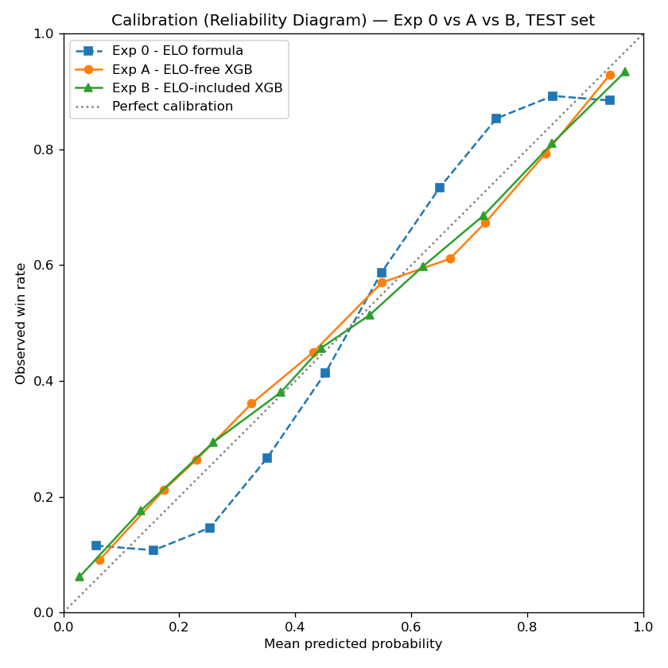
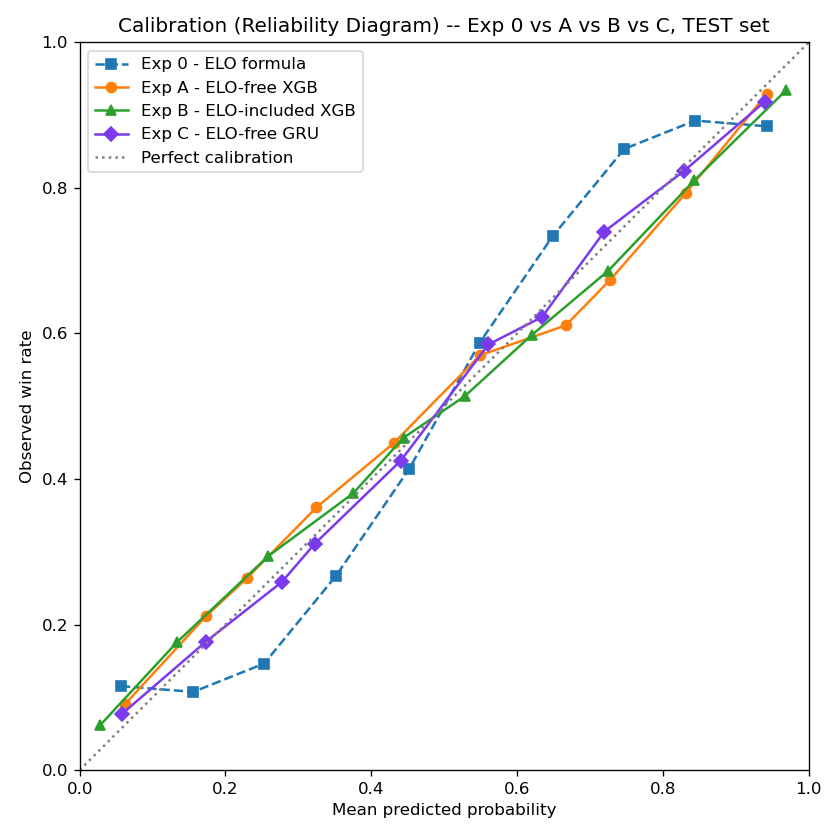

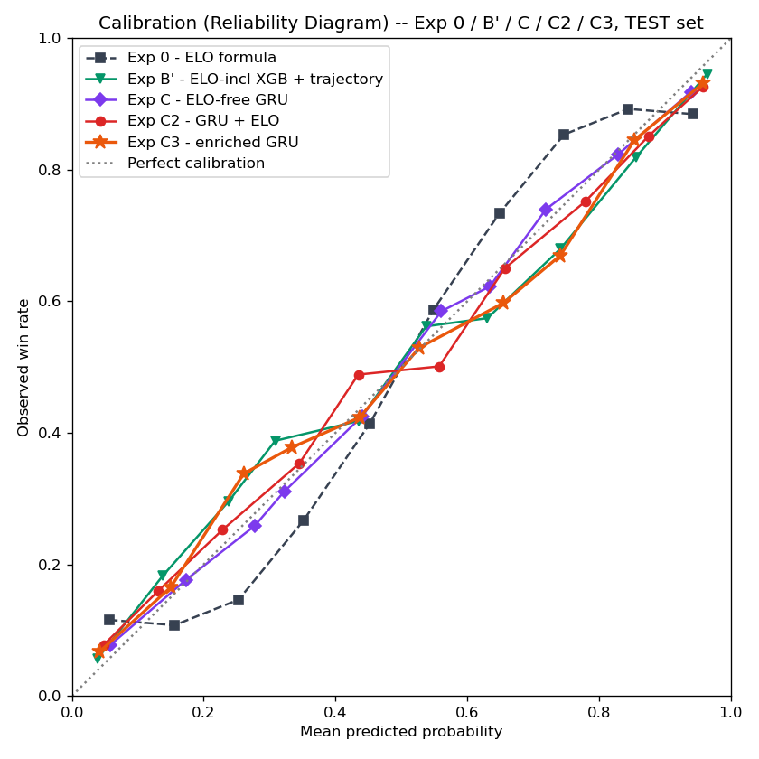
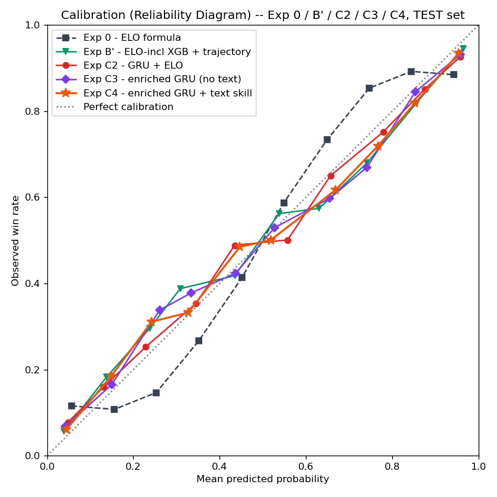

**Feature importance (XGBoost variants):**

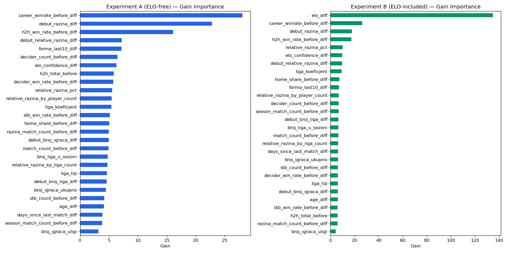
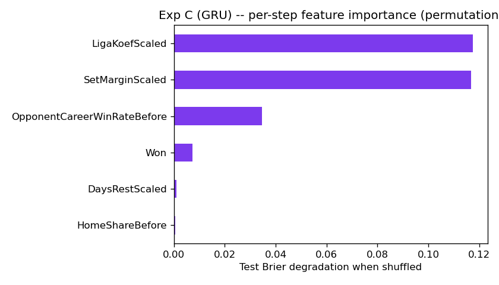


**GRU training curves:**

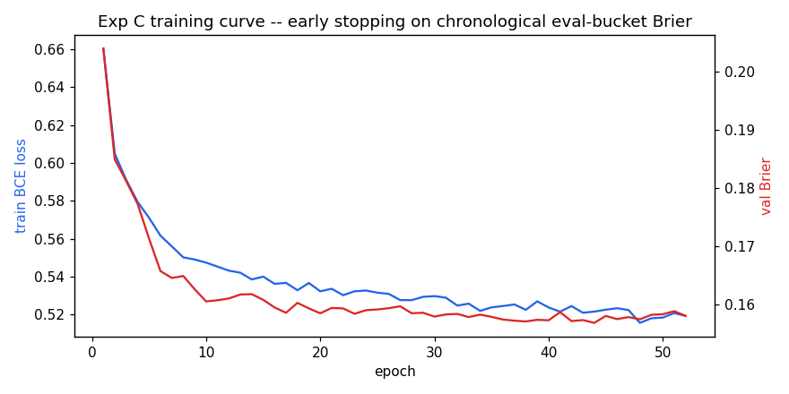
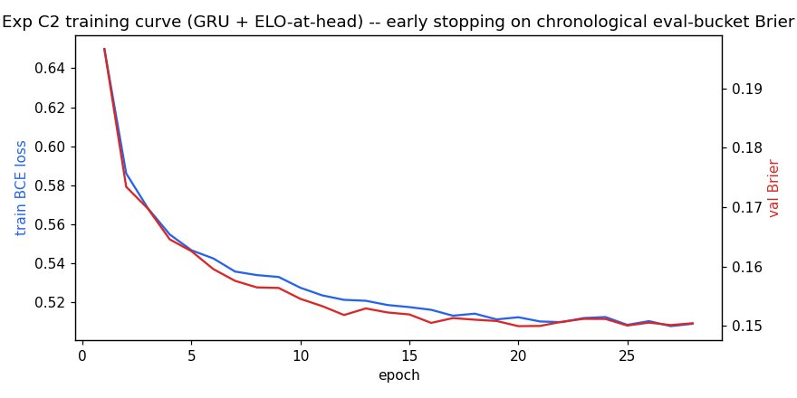
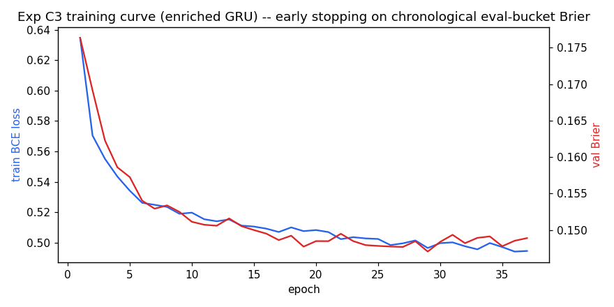
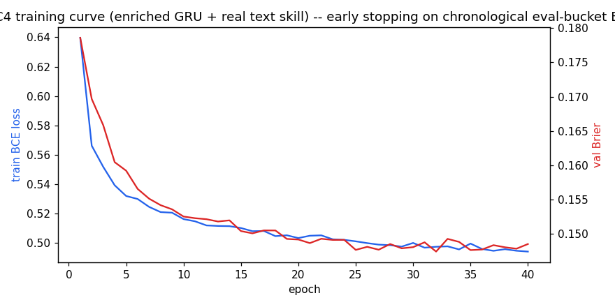

**Walk-forward cross-validation (Brier score by fold):**

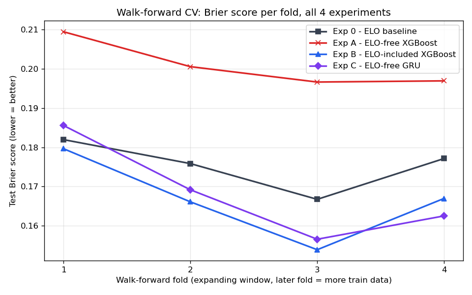
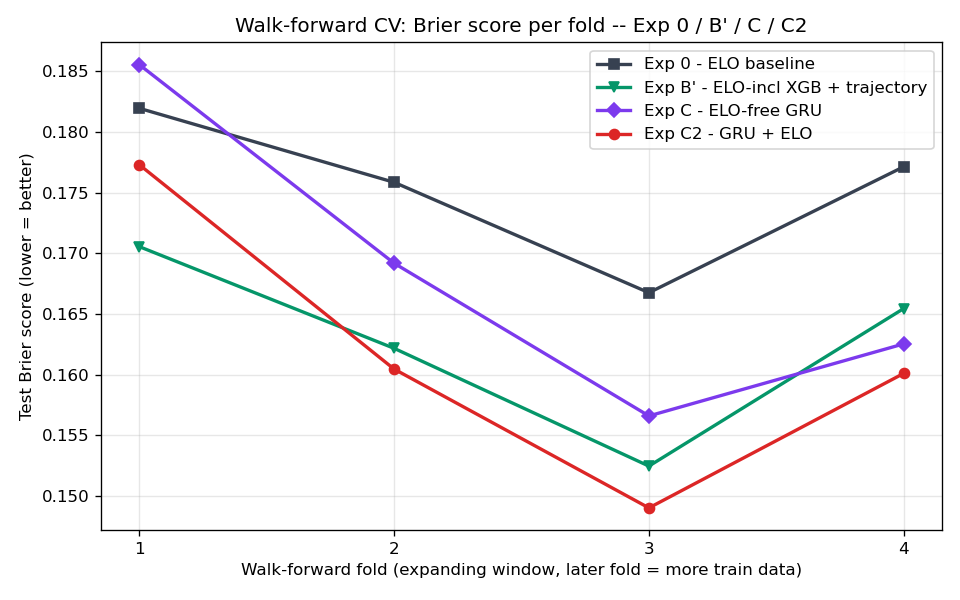
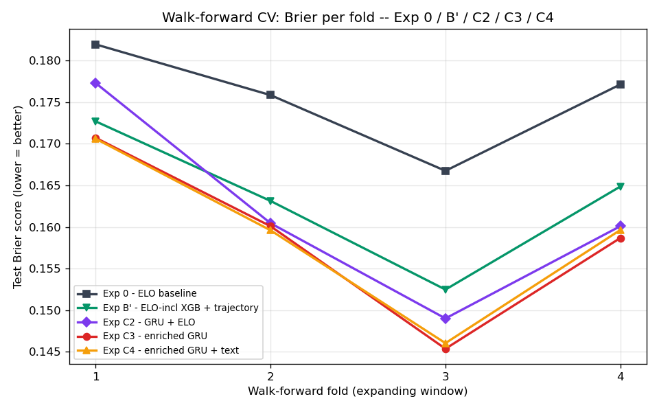

## Folder Layout

```
.
├── README.md                   # this file
├── .gitignore                  # excludes db-config.json, .env*, data/*.{csv,parquet,json,jsonl,log}, __pycache__/, .ipynb_checkpoints/, node_modules/
├── requirements.txt            # pandas, numpy, scikit-learn, xgboost, torch (CPU), jupyterlab, matplotlib
├── package.json / package-lock.json   # Node.js deps for the data-export scripts (mssql)
├── data/
│   └── README.md               # exporter, schema, data-quality findings — the only file actually
│                                # committed here. matches_export.csv, features.parquet,
│                                # test_predictions*.parquet, trenutci_scores.csv, etc. are all
│                                # gitignored (real player IDs / PII) — regenerate locally via the
│                                # scripts below if you have your own data source
├── notebooks/                  # 01–16, see table above
├── scripts/
│   ├── db-config.json          # local DB credentials (gitignored, never committed — supply your own)
│   ├── test_connection.mjs     # one-off DB connectivity check
│   ├── step0_pin_startdate.mjs # pins @StartDate to the real Sezona.DatumOd
│   ├── check_age_columns.mjs   # P1 finding: DatumRodjenja is 100% NULL, use Godiste instead
│   ├── p1_checks.mjs           # empirical Phase P1 data-quality checks
│   ├── export_data.mjs         # the exporter — writes ../data/matches_export.csv
│   ├── verify_export.mjs       # sanity checks on the exported CSV
│   ├── get_inscope_players.mjs # writes ../data/inscope_player_ids.json (779 in-scope players)
│   ├── export_trenutci.mjs / dump_trenutci_txt.mjs  # exports raw Trenutci free-text for scoring
│   ├── score_trenutci.mjs / build_trenutci_scores_csv.mjs / csv-utils.mjs  # Gemini scoring pipeline → ../data/trenutci_scores.csv (Exp C4)
│   ├── exp_c3_validate.py / exp_c4_validate.py  # standalone end-to-end runtime-safety validation for notebooks 10/11, run before assembly
│   └── wf_c3c4_common.py / run_walkforward_c3c4.py  # shared fold-independent setup + the full 4-fold × 5-model walk-forward loop behind notebook 12
├── serving/                     # ONNX export + precompute pipeline for Exp C3 (see "Serving"
│                                 # above) — the exported model was later deployed as a live feature
│                                 # in the private club app; that app itself is not part of this repo
│   ├── data_source.py           # swappable raw-match source: local SQL Server (dev) or production HTTP endpoint
│   ├── feature_pipeline.py      # point-in-time feature construction, shared logic with the notebooks
│   ├── model.py                 # GRU model definition used to build/run the exported ONNX graph
│   ├── onnx_export.py           # exports the trained PyTorch GRU (Exp C3) to ONNX
│   ├── precompute_gru_matrix.py # batch job — precomputes pairwise win-probabilities for the full player roster
│   └── models/
│       ├── exp_c3.onnx           # exported Exp C3 model graph
│       ├── exp_c3_isotonic.pkl   # calibration model (isotonic regression)
│       └── exp_c3_scaling.json   # feature scaling stats + hyperparameters + test metrics
└── models/                      # committed chart PNGs (the large trained *.pkl/*.pt model
                                  # artifacts are gitignored — regenerable from training, see below)
```

## Running

### Data export (Node.js, requires DB access)

```bash
npm install                       # installs mssql from the repo-root package.json
cd scripts
node test_connection.mjs          # verify DB connectivity
node step0_pin_startdate.mjs       # confirm the @StartDate boundary (already pinned: 2017-05-01)
node export_data.mjs               # writes ../data/matches_export.csv (~100s, one-time)
node verify_export.mjs             # sanity checks on the exported CSV
```

### Notebooks (Python)

```bash
python -m venv .venv
.venv/Scripts/activate    # Windows
pip install -r requirements.txt
jupyter lab notebooks/
# Run 01 -> 02 -> 03 -> 04 -> 05 -> 06 -> 07 -> 08 -> 09 -> 10 -> 11 -> 12 -> 13 in order — each
# consumes the previous notebook's saved parquet/json/pkl artifacts.
```

Notebooks 10–12 additionally rely on standalone scripts in `scripts/` that were run in the
background *before* each notebook was assembled, to validate runtime safety and (for 12) to avoid
re-running a ~12-minute GRU training loop inside the notebook kernel itself:

```bash
cd scripts
python exp_c3_validate.py            # notebook 10 runtime-safety check (~98s)
python exp_c4_validate.py            # notebook 11 runtime-safety check (~110s)
python run_walkforward_c3c4.py --folds 1,2,3,4   # the full 4-fold x 5-model walk-forward behind notebook 12 (~721s)
```

### Serving (Python, from the repo root — `serving/` is a package)

```bash
pip install -r serving/requirements-serving.txt
python -m serving.onnx_export                                  # re-export models/*.pt -> serving/models/
python -m serving.precompute_gru_matrix --source sql --dry-run --limit 10   # local smoke test
```

`--source sql` requires `scripts/db-config.json` (see `data/README.md`); `--source php` is the
production shape and instead calls the private club app's raw-match HTTP endpoint. Both paths are
local/CLI-only in this repo — the actual nightly production run happens inside the private club
app's own Vercel Cron job, which imports this same `serving/` code unchanged.

## Honest Limitations

- **Single-club, single-league dataset** (~17k matches, ~9 years) — findings are directional and
  well-verified *for this dataset*, not a universal claim about GRUs beating ELO in general.
- **NN training carries residual seed-to-seed stochasticity** even with a fixed seed. A 3-seed
  stability check (notebook 05) supports the ELO-free GRU's edge over ELO being real, but is not a
  full multi-seed distribution across every experiment, including Exp C3/C4.
- **Walk-forward CV uses only 4 folds**, each itself a few thousand matches — fold-level
  conclusions (the original fold-1 "B′ wins" result in `09`, and the fold-1 "enriched GRU wins" /
  fold-3-4 C3-vs-C4 sign flip in `12`) rest on individually noisy test slices, even though the
  aggregate pattern is consistent enough across all 4 to be credible. Bootstrap CIs were not re-run
  per walk-forward fold in either `09` or `12` (would be redundant with notebook 06's/10's/11's
  methodology and outside the runtime budget) — this specifically leaves the C3-vs-C4 per-fold sign
  flip without fold-level significance testing, the natural next step if that question needs to be
  settled more rigorously.
- **No hyperparameter grid search for the trajectory/ELO+GRU/enriched-GRU variants** — A′/B′/C2/
  C3/C4 all reuse the tuned hyperparameters from the original Exp A/B/C, by design (isolating the
  effect of each new feature/architecture change, not re-tuning around it).
- **The LLM text-skill score (Exp C4) comes from a single Gemini scoring pass** over `Trenutci`
  free text — no repeated-sampling or multi-model check of the score's own reliability, and ~14% of
  in-scope players have no text at all (neutral-filled + explicitly flagged via `has_text`, not
  imputed from any other signal).

## Never Commit

This is the public repo — the `.gitignore` here is the actual enforced boundary, not a future
intention. The following never get committed:

- `scripts/db-config.json` — real read-only DB credentials (supply your own to regenerate the export)
- `data/matches_export.csv`, `data/*.parquet`, `data/trenutci_scores.csv` — real player IDs, match
  results, and `Trenutci` free-text self-descriptions / LLM-derived skill scores (PII)
- `models/*.pkl`, `models/*.pt` — the large trained model artifacts (regenerable from training);
  only the chart PNGs are kept under `models/` in this repo. **Exception:** `serving/models/*` (the
  exported ONNX graph, isotonic calibrator, and scaling JSON for Exp C3) is small (~KB-scale, not
  the full training checkpoint) and *is* intentionally committed — it's the actual serving artifact
  this repo ships, not a regenerable-but-bulky training byproduct.
