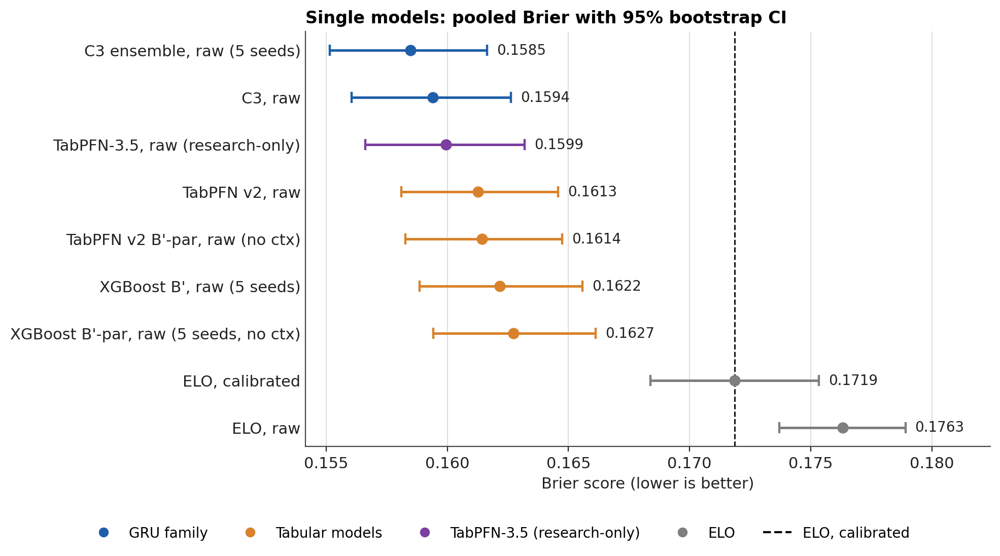
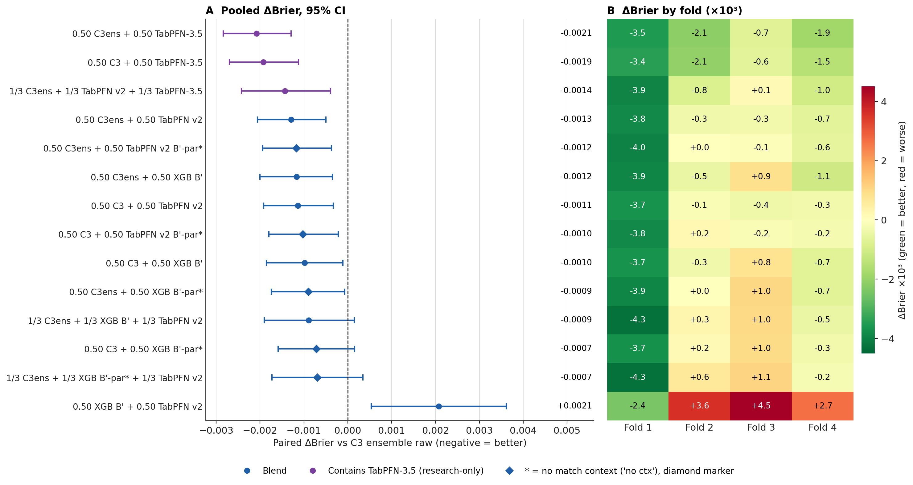
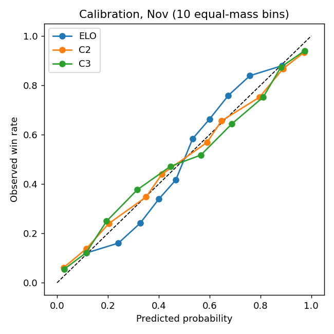
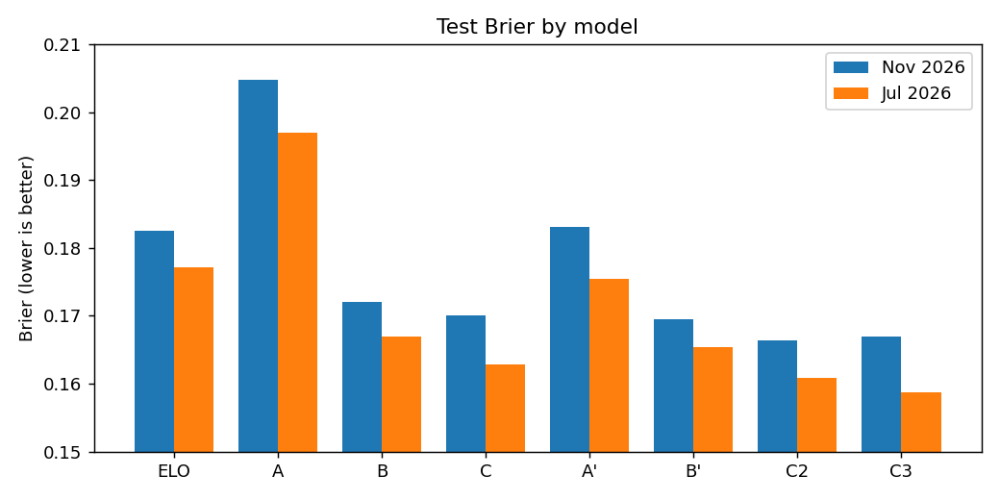
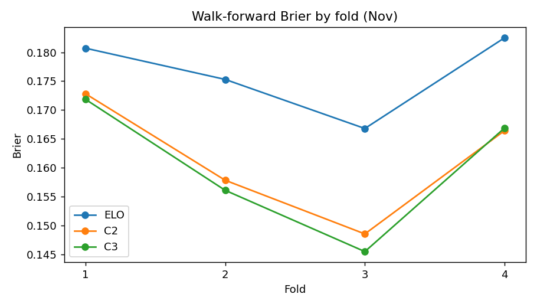
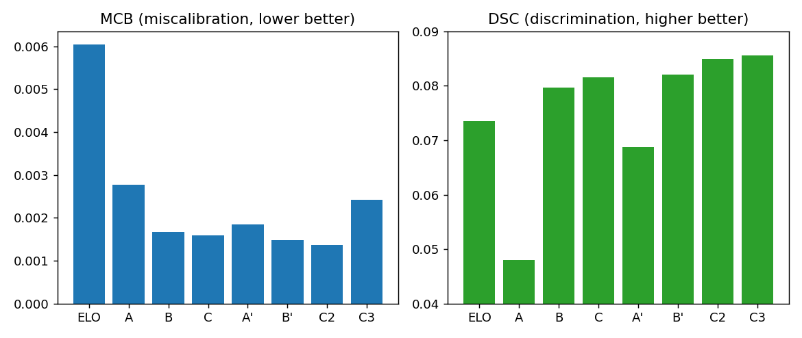
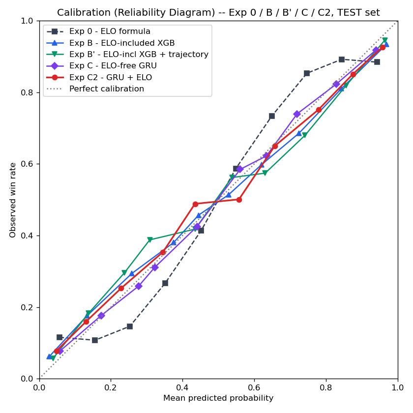
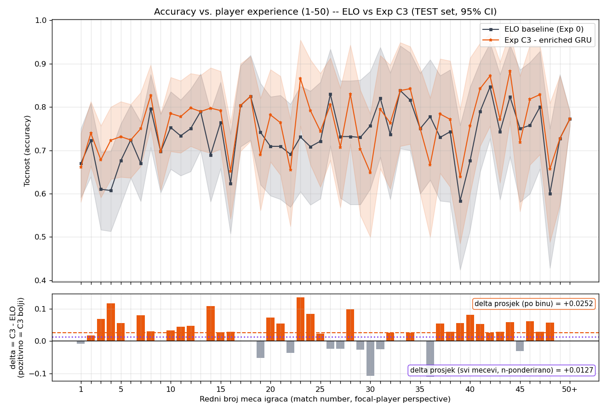
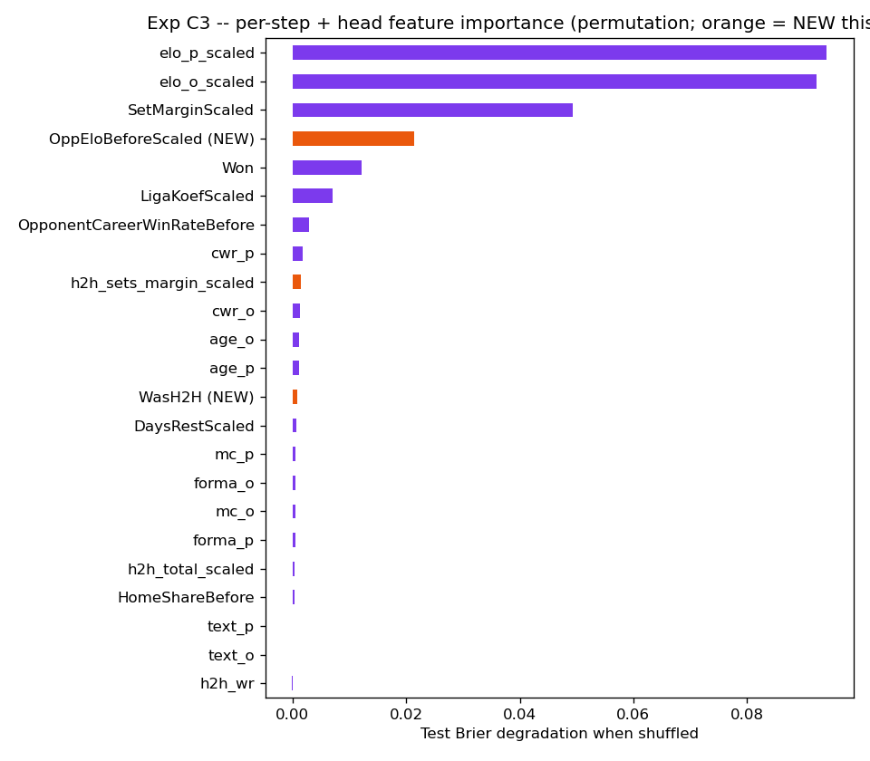
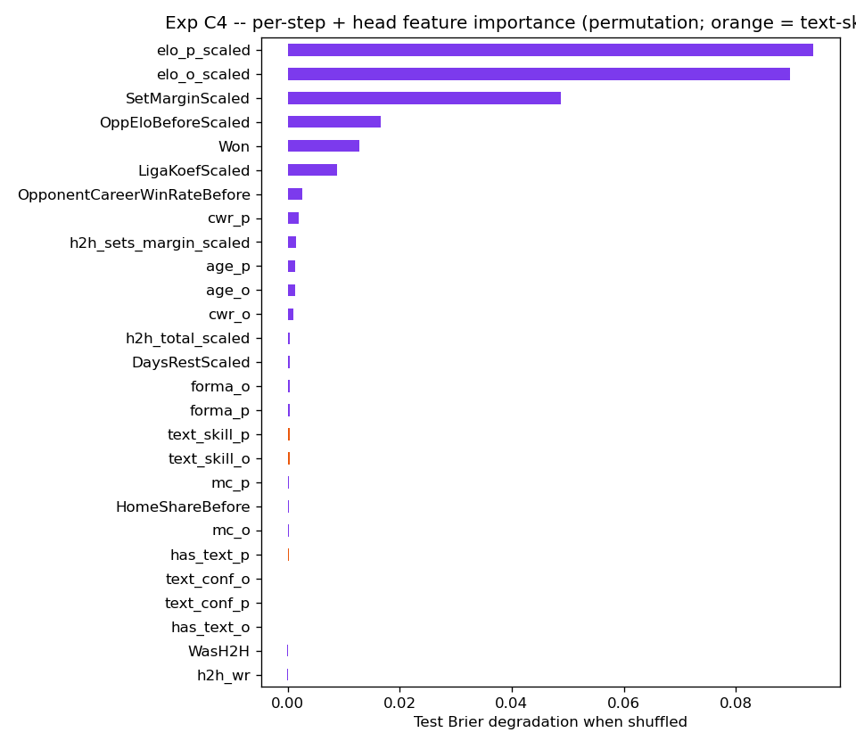

# Beating ELO With Raw Match History: Win-Probability Models for Tenis Liga Split

**Contents:** [Abstract](#abstract) · [1 Introduction](#1-introduction) · [2 Data](#2-data) ·
[3 Methods](#3-methods) · [4 Results](#4-results) · [5 Discussion](#5-discussion) ·
[6 Conclusion](#6-conclusion) · [References](#references) · [Appendix A Notebooks](#appendix-a-notebooks) ·
[B Figures](#appendix-b-additional-figures) · [C Layout](#appendix-c-repository-layout) ·
[D Serving](#appendix-d-serving) · [E Reproduction](#appendix-e-reproducing-the-results) ·
[F Data and licences](#appendix-f-data-and-licence-notes)

This is a standalone research project with its own dependencies (`requirements.txt` for the
notebooks, `package.json` for the Node.js export scripts). It grew out of statistics work for the
club-management app of a real recreational league, but every notebook and script reads only
exported files under `data/`; nothing imports from outside this repository.

## Abstract

Rating systems such as ELO convert match history into win probabilities. This study asks whether
learned models can outperform the incumbent ELO of Tenis Liga Split, a recreational tennis league
(singles, about 18k matches since 2017, pseudonymized), and whether they can do so without ELO as an
input. Leakage-safe point-in-time features, 4-fold walk-forward validation (14,428 pooled test
matches) and a paired match-level bootstrap are used to compare ELO, XGBoost, two-tower GRU sequence
models, zero-shot TabPFN and fixed-weight blends. The ELO baseline is isotonic-calibrated on the same
slice as the models; comparing against raw ELO overstates every gain by about 2.5 percentage points.
Against calibrated ELO, a 5-seed GRU ensemble reduces Brier score by 7.8%, the best permitted blend
(GRU ensemble + TabPFN v2) by 8.6%, and a research-only blend with TabPFN-3.5 by 9.0%; accuracy is
about 76.5% versus 74.9% for ELO. An ELO-free GRU also beats ELO on an earlier data snapshot. The
results come from a single league and are directional rather than universal.

### Key results

**Table 1.** Pooled walk-forward test performance (14,428 matches). Models use raw (uncalibrated)
output; ELO is shown both ways. TabPFN-3.5 is research-only (non-commercial licence, see §4.5).

| Model | Brier | % vs calibrated ELO | Accuracy |
|---|---|---|---|
| ELO (raw) | 0.17633 | −2.6% | 74.88% |
| ELO (isotonic-calibrated) | 0.17187 | — | 74.65% |
| XGBoost B′ (5 seeds) | 0.16217 | 5.6% | 75.81% |
| TabPFN v2 | 0.16127 | 6.2% | 75.85% |
| GRU C3 (single seed) | 0.15940 | 7.3% | 76.33% |
| GRU C3 ensemble (5 seeds) | 0.15847 | 7.8% | 76.60% |
| 0.5·C3 ensemble + 0.5·TabPFN v2 (best permitted blend) | 0.15716 | 8.6% | 76.47% |
| 0.5·C3 ensemble + 0.5·TabPFN-3.5 (*research-only*) | 0.15638 | 9.0% | 76.80% |



**Figure 1.** Pooled Brier score with 95% match-level bootstrap intervals for single models
(Table 2); lower is better.

## 1 Introduction

ELO turns a sequence of results into a skill estimate and a win probability (Elo, 1978). It is
simple, transparent and hard to beat, but it compresses a player's history into one number and
ignores match context (rest, league tier, home court, head-to-head). The research questions are:

- **RQ1.** Can a model that never sees the ELO number beat ELO?
- **RQ2.** How much do ELO-included models add over ELO-free counterparts?
- **RQ3.** How does a pretrained tabular foundation model (TabPFN), used zero-shot, compare with
  trained models (XGBoost, GRU)?
- **RQ4.** Does combining a sequence model with a tabular model improve on either alone?

Contributions: (i) a leakage-safe point-in-time pipeline with a time-based evaluation protocol;
(ii) an ELO-free GRU that beats ELO and an enriched ELO-included GRU as best single model; (iii) a
zero-shot TabPFN comparison; (iv) fixed-weight GRU + tabular blends with paired significance tests;
(v) a record of results that did not survive scrutiny (an early single-split overclaim, a null
result for LLM-derived text features).

## 2 Data

Singles matches (`SM`/`SF` leagues) of Tenis Liga Split from 2017-05-01 onwards are exported from a
read-only SQL Server database by `scripts/export_data.mjs` (details and data-quality findings in
`data/README.md`). Masters, doubles pairs and friendly matches are excluded. Each match yields two
rows, one per player perspective, with asymmetric features expressed as differences. The November
snapshot is pseudonymized (identifiers replaced, birth year reduced to age; the mapping stays
private). Raw exports and per-match predictions are never committed (Appendix F).

**Table A.** The two data snapshots (not directly comparable).

| | July 2026 | November 2026 |
|---|---|---|
| Matches | ~17,128 | refreshed, pseudonymized (~18k) |
| Split | chronological 80/20; test 3,426 matches | chronological; test 3,607 matches (= walk-forward fold 4) |
| Walk-forward | 4 expanding folds (notebooks 06, 09, 12) | 4 expanding folds, 14,428 test matches pooled (notebooks 14–18) |
| Models | 0, A, A′, B, B′, C, C2, C3, C4 | 0, A, A′, B, B′, C, C2, C3 (+5-seed ensemble), TabPFN, XGBoost B′, blends |

Experiment C4 (July only) uses a side table of LLM-scored free-text player descriptions
(`data/trenutci_scores.csv`, gitignored); see notebook 11.

## 3 Methods

### 3.1 Features and evaluation protocol

Every feature is computed strictly as of the moment before the match, with SQL window functions or
the equivalent pandas `groupby`/`shift`/`cumcount` patterns. Features are tagged *ELO-derived*
(excluded from ELO-free experiments), *ELO-substitute* (opponent quality from the win/loss graph,
league-tier structure or pre-ELO signup data) or *neutral context* (rest, age, home court). Splits
are chronological, never random. Duplicate-and-flip expansion makes the dataset symmetric in the two
perspectives, but not the trained models themselves (§3.4).

**Metrics.** The primary metric is the Brier score (Brier, 1950),

$$\mathrm{BS}=\frac1N\sum_{i=1}^{N}(p_i-y_i)^2,$$

with AUC and accuracy as secondary metrics. Accuracy is computed over both perspectives of each
match; an exact tie ($p=0.5$) counts as half a point. ELO's probability is
$p=1/(1+10^{-\Delta/400})$ with $\Delta$ the rating difference. Calibration is assessed by ECE
(10 equal-mass bins) and the CORP decomposition $\mathrm{BS}=\mathrm{MCB}-\mathrm{DSC}+\mathrm{UNC}$
(Dimitriadis et al., 2021).

**Inference.** A paired match-level bootstrap (2,000 resamples, seed 42, identical resamples across
comparisons) gives 95% intervals and Brier differences; both perspective rows of a match are
resampled together. Walk-forward validation uses 5 chronological blocks, i.e. 4 expanding folds
(fold $k$ trains on blocks $1..k$ and tests on block $k+1$); "folds better" counts the folds in
which a model has lower Brier than its reference.

### 3.2 Models

**Table B.** Model families.

| Model | Description | ELO input |
|---|---|---|
| 0 — ELO | Closed form, no fitting; raw and isotonic-calibrated variants | yes |
| A / A′ | XGBoost on ELO-substitute features; A′ adds 9 league-tier trajectory features | no |
| B / B′ | A / A′ plus `elo_diff`; B′ = 37 features | yes |
| C | Two-tower shared-weight GRU (Cho et al., 2014) on each player's raw match sequence | no |
| C2 / C3 | C with ELO at the head; C3 adds opponent ELO and H2H per step and 15 enriched head scalars; C3ens = 5-seed ensemble | yes |
| C4 | C3 with an LLM-scored text-skill prior (July snapshot only) | yes |
| TabPFN v2 | Zero-shot (Hollmann et al., 2025), B′ features, ≤10k most recent training rows as context, 3 seeds | yes |
| TabPFN-3.5 | Zero-shot, B′ features, full fold context, 1 seed. *Research-only: non-commercial licence, run locally with network access blocked, never used in production* | yes |
| B′-pair | B′ without match-context columns undefined for an arbitrary player pair (variants for XGBoost and TabPFN v2) | yes |

Hyperparameters of the GRU and XGBoost (Chen & Guestrin, 2016) come from the original Exp A/B/C
tuning and are reused by design. XGBoost results in the final comparison are averages over 5 seeds.

### 3.3 Calibration

The ELO baseline is calibrated by isotonic regression (Zadrozny & Elkan, 2002) on the same
calibration slice used for the models (the last 15% of each training window, never test data).
Since raw ELO is clearly miscalibrated, the calibrated ELO is the fair baseline and is the primary
reference; improvements over raw ELO are also reported and are about 2.5 points larger. For every
learned model both raw and calibrated outputs are evaluated (Table 3); raw is better for all of
them, so raw outputs are used throughout.

### 3.4 Symmetrization and blending

GRU and XGBoost see the two perspectives as separate inputs and are not exactly antisymmetric. Their
predictions are symmetrized,

$$p_{\mathrm{sym}}=\tfrac12\bigl(p_{AB}+1-p_{BA}\bigr),$$

before blending (ELO and TabPFN are already exactly symmetric). A blend is a fixed-weight average

$$p=\sum_k w_k\,p_k,\qquad \sum_k w_k=1,$$

with weights set before any result was inspected (0.5/0.5, or 1/3 each); nothing is fitted on test
data. The effect of symmetrization on Brier is negligible (§4.5).

## 4 Results

"% vs cal. ELO" is the Brier reduction relative to calibrated ELO; Δ denotes paired Brier
differences (negative = first model better); bold marks 95% intervals entirely below zero. Numbers
in 4.1–4.3 are pooled over the 4 walk-forward folds (14,428 matches, November snapshot).

### 4.1 Single models

**Table 2.** Single models, raw output.

| Model | Brier [95% CI] | % vs cal. ELO | % vs raw ELO | Accuracy | AUC |
|---|---|---|---|---|---|
| C3 ensemble (5 GRU) | 0.15847 [0.15515, 0.16164] | 7.8% | 10.1% | 76.60% | 0.8491 |
| C3 (single seed) | 0.15940 [0.15605, 0.16263] | 7.3% | 9.6% | 76.33% | 0.8474 |
| TabPFN-3.5 *(research-only)* | 0.15995 [0.15662, 0.16320] | 6.9% | 9.3% | 76.27% | 0.8465 |
| TabPFN v2 | 0.16127 [0.15809, 0.16457] | 6.2% | 8.5% | 75.85% | 0.8438 |
| TabPFN v2 B′-pair *(no match context)* | 0.16144 [0.15827, 0.16474] | 6.1% | 8.4% | 75.75% | 0.8435 |
| XGBoost B′ (5 seeds) | 0.16217 [0.15886, 0.16558] | 5.6% | 8.0% | 75.81% | 0.8423 |
| XGBoost B′-pair (5 seeds) *(no match context)* | 0.16274 [0.15943, 0.16612] | 5.3% | 7.7% | 75.68% | 0.8412 |
| ELO (calibrated) | 0.17187 [0.16839, 0.17533] | — | 2.5% | 74.65% | 0.8224 |
| ELO (raw) | 0.17633 [0.17369, 0.17891] | −2.6% | — | 74.88% | 0.8246 |

All learned models beat both ELO variants; the top models differ by less than 0.5 pp in accuracy
with overlapping intervals, so Brier and AUC are what separate them. TabPFN v2, without any
training, trails the trained GRU by about 1% in Brier; TabPFN-3.5 (research-only) reaches the
single-seed GRU but not the 5-seed ensemble.

### 4.2 Raw versus calibrated output

**Table 3.** Brier score before and after isotonic calibration on the shared calibration slice.

| Model | Raw | Calibrated | Better |
|---|---|---|---|
| C3 | 0.15940 | 0.16009 | raw |
| C3 ensemble | 0.15847 | 0.15889 | raw |
| TabPFN v2 | 0.16127 | 0.16219 | raw |
| TabPFN-3.5 *(research-only)* | 0.15995 | 0.16088 | raw |
| XGBoost B′ (5 seeds) | 0.16217 | 0.16270 | raw |
| XGBoost B′-pair (5 seeds) | 0.16274 | 0.16329 | raw |
| ELO | 0.17633 | 0.17187 | calibrated |

Calibration helps only ELO and slightly hurts every learned model.

### 4.3 Blends

**Table 4.** Fixed-weight blends (top 8 of 14 by Brier; full grid in the collapsible Table 4b).
Δ is relative to the raw 5-seed C3 ensemble.

| Blend | Brier [95% CI] | % vs cal. ELO | Δ vs C3ens [95% CI] | Folds better | Accuracy |
|---|---|---|---|---|---|
| 0.5·C3ens + 0.5·TabPFN-3.5 *(research-only)* | 0.15638 [0.15319, 0.15958] | 9.0% | **-0.00208 [-0.00284, -0.00129]** | 4/4 | 76.80% |
| 0.5·C3 + 0.5·TabPFN-3.5 *(research-only)* | 0.15654 [0.15337, 0.15973] | 8.9% | **-0.00192 [-0.00270, -0.00112]** | 4/4 | 76.70% |
| (C3ens + TabPFN v2 + TabPFN-3.5) / 3 *(research-only)* | 0.15703 [0.15380, 0.16024] | 8.6% | **-0.00143 [-0.00243, -0.00039]** | 3/4 | 76.57% |
| 0.5·C3ens + 0.5·TabPFN v2 | 0.15716 [0.15393, 0.16034] | 8.6% | **-0.00129 [-0.00206, -0.00050]** | 4/4 | 76.47% |
| 0.5·C3ens + 0.5·TabPFN v2 B′-pair *(no match context)* | 0.15728 [0.15404, 0.16053] | 8.5% | **-0.00117 [-0.00194, -0.00037]** | 3/4 | 76.47% |
| 0.5·C3ens + 0.5·XGBoost B′ | 0.15729 [0.15400, 0.16051] | 8.5% | **-0.00116 [-0.00200, -0.00035]** | 3/4 | 76.70% |
| 0.5·C3 + 0.5·TabPFN v2 | 0.15731 [0.15406, 0.16052] | 8.5% | **-0.00114 [-0.00191, -0.00033]** | 4/4 | 76.48% |
| 0.5·C3 + 0.5·TabPFN v2 B′-pair *(no match context)* | 0.15743 [0.15418, 0.16066] | 8.4% | **-0.00102 [-0.00180, -0.00022]** | 3/4 | 76.49% |




**Figure 2.** Brier difference to the C3 ensemble per walk-forward fold for all 14 blends of Table 4b;
negative values favour the blend.

<details>
<summary>Table 4b. Full blend grid (14 blends; adds Δ vs single-seed C3 and AUC)</summary>

| Blend | Brier [95% CI] | % vs cal. ELO | Δ vs C3ens [95% CI] | Folds better | Δ vs C3 [95% CI] | Accuracy | AUC |
|---|---|---|---|---|---|---|---|
| 0.5·C3ens + 0.5·TabPFN-3.5 *(research-only)* | 0.15638 [0.15319, 0.15958] | 9.0% | **-0.00208 [-0.00284, -0.00129]** | 4/4 | **-0.00291 [-0.00381, -0.00204]** | 76.80% | 0.8534 |
| 0.5·C3 + 0.5·TabPFN-3.5 *(research-only)* | 0.15654 [0.15337, 0.15973] | 8.9% | **-0.00192 [-0.00270, -0.00112]** | 4/4 | **-0.00275 [-0.00356, -0.00194]** | 76.70% | 0.8531 |
| (C3ens + TabPFN v2 + TabPFN-3.5) / 3 *(research-only)* | 0.15703 [0.15380, 0.16024] | 8.6% | **-0.00143 [-0.00243, -0.00039]** | 3/4 | **-0.00226 [-0.00335, -0.00116]** | 76.57% | 0.8522 |
| 0.5·C3ens + 0.5·TabPFN v2 | 0.15716 [0.15393, 0.16034] | 8.6% | **-0.00129 [-0.00206, -0.00050]** | 4/4 | **-0.00212 [-0.00302, -0.00122]** | 76.47% | 0.8519 |
| 0.5·C3ens + 0.5·TabPFN v2 B′-pair *(no match context)* | 0.15728 [0.15404, 0.16053] | 8.5% | **-0.00117 [-0.00194, -0.00037]** | 3/4 | **-0.00200 [-0.00289, -0.00111]** | 76.47% | 0.8517 |
| 0.5·C3ens + 0.5·XGBoost B′ | 0.15729 [0.15400, 0.16051] | 8.5% | **-0.00116 [-0.00200, -0.00035]** | 3/4 | **-0.00199 [-0.00290, -0.00110]** | 76.70% | 0.8517 |
| 0.5·C3 + 0.5·TabPFN v2 | 0.15731 [0.15406, 0.16052] | 8.5% | **-0.00114 [-0.00191, -0.00033]** | 4/4 | **-0.00197 [-0.00279, -0.00113]** | 76.48% | 0.8516 |
| 0.5·C3 + 0.5·TabPFN v2 B′-pair *(no match context)* | 0.15743 [0.15418, 0.16066] | 8.4% | **-0.00102 [-0.00180, -0.00022]** | 3/4 | **-0.00185 [-0.00266, -0.00102]** | 76.49% | 0.8513 |
| 0.5·C3 + 0.5·XGBoost B′ | 0.15746 [0.15416, 0.16072] | 8.4% | **-0.00098 [-0.00186, -0.00011]** | 3/4 | **-0.00181 [-0.00269, -0.00098]** | 76.56% | 0.8513 |
| 0.5·C3ens + 0.5·XGBoost B′-pair *(no match context)* | 0.15755 [0.15433, 0.16075] | 8.3% | **-0.00090 [-0.00174, -0.00007]** | 2/4 | **-0.00173 [-0.00267, -0.00084]** | 76.76% | 0.8513 |
| (C3ens + XGBoost B′ + TabPFN v2) / 3 | 0.15757 [0.15437, 0.16077] | 8.3% | -0.00089 [-0.00190, +0.00015] | 2/4 | **-0.00172 [-0.00283, -0.00065]** | 76.51% | 0.8512 |
| 0.5·C3 + 0.5·XGBoost B′-pair *(no match context)* | 0.15773 [0.15449, 0.16097] | 8.2% | -0.00072 [-0.00159, +0.00015] | 2/4 | **-0.00155 [-0.00242, -0.00070]** | 76.54% | 0.8509 |
| (C3ens + XGBoost B′-pair + TabPFN v2) / 3 *(no match context)* | 0.15775 [0.15456, 0.16093] | 8.2% | -0.00070 [-0.00173, +0.00035] | 2/4 | **-0.00153 [-0.00264, -0.00045]** | 76.48% | 0.8509 |
| 0.5·XGBoost B′ + 0.5·TabPFN v2 (no GRU) | 0.16053 [0.15723, 0.16381] | 6.6% | +0.00207 [+0.00054, +0.00361] | 1/4 | +0.00124 [-0.00040, +0.00284] | 75.88% | 0.8454 |


</details>

A GRU + tabular blend is significantly better than the 5-seed GRU ensemble alone (Δ ≈ −0.0012 to
−0.0013 for TabPFN v2 or XGBoost B′ partners). The gain is concentrated in fold 1 (§5.2). The
no-context B′-pair partners are within 0.0002 Brier of their full-feature counterparts, and the two
tabular models are interchangeable as partners. A blend of the two tabular models without a GRU is
clearly worse than any GRU blend, and adding both tabular models to the GRU does not help (residual
correlation of the GRU with either tabular model is about 0.95–0.96, between the tabular models
about 0.98). The TabPFN-3.5 blends are best by Brier but research-only.

### 4.4 Earlier experiments (July snapshot)

**Table 5.** July 2026 snapshot, single chronological split (3,426 test matches), calibrated
outputs; ratios are against raw ELO and are not comparable to Tables 1–4.

| Experiment | ELO input | Brier | vs ELO | Accuracy |
|---|---|---|---|---|
| 0 — ELO | — | 0.1771 | — | 75.18% |
| A — ELO-free XGBoost | no | 0.1969 | +11.2% (worse) | 70.18% |
| A′ — + league-tier trajectory | no | 0.1754 | −0.97% | 73.44% |
| B — XGBoost with ELO | yes | 0.1670 | −5.7% | 75.20% |
| B′ — + trajectory | yes | 0.1655 | −6.6% | 75.61% |
| **C — GRU, ELO-free** | no | **0.1628** | **−8.1%** | **76.21%** |
| C2 — GRU + ELO | yes | 0.1609 | −9.2% | 76.02% |
| **C3 — enriched GRU** | yes | **0.1587** | **−10.4%** | **76.44%** |
| C4 — C3 + LLM text skill | yes | 0.1598 | −9.8% | 76.08% |

Exp C never sees any ELO value and still beats ELO on every metric (RQ1). In the July walk-forward
(mean Brier over 4 folds: ELO 0.1754, B′ 0.1633, C2 0.1617, C3 0.1587, C4 0.1590) the enriched
GRUs C3/C4 occupy the top two places in every fold.

<details>
<summary>Table 5b. Earlier November tables (calibrated outputs, 1-seed XGBoost): main split with ECE and CORP</summary>

These numbers predate the fair comparison and are superseded for ranking by Tables 1–4; they are
kept for the ECE and CORP decomposition (ECE in pp, 10 equal-mass bins; BS = MCB − DSC + 0.25).
Main split of notebook 00 (3,607 matches).

| Exp | Brier (Nov) | Brier (Jul) | ECE (Nov) | MCB | DSC |
|---|---|---|---|---|---|
| 0 ELO | 0.1825 | 0.1771 | 5.7 | 0.0060 | 0.0735 |
| A | 0.2048 | 0.1969 | 4.5 | 0.0028 | 0.0480 |
| A′ | 0.1830 | 0.1754 | 3.2 | 0.0018 | 0.0688 |
| B | 0.1720 | 0.1670 | 2.6 | 0.0017 | 0.0797 |
| B′ | 0.1695 | 0.1655 | 2.9 | 0.0015 | 0.0820 |
| C | 0.1700 | 0.1628 | 2.4 | 0.0016 | 0.0816 |
| C2 | 0.1664 | 0.1609 | 2.6 | 0.0014 | 0.0849 |
| C3 | 0.1669 | 0.1587 | 3.7 | 0.0024 | 0.0855 |
| TabPFN v2 (3-seed mean) | 0.1688 | — | 2.9 | 0.0013 | 0.0826 |
| TabPFN-3.5 *(research-only)* | 0.1666 | — | 1.9 | 0.0011 | 0.0845 |

Versus raw ELO, C3's Brier gain is about three quarters better discrimination (ΔDSC = +0.0116
[+0.0079, +0.0155]) and one quarter better calibration (ΔMCB = −0.0040 [−0.0069, −0.0012]). On this
split C3 and C2 are statistically tied (ΔBrier −0.0005 [−0.0031, +0.0021]).

November walk-forward mean Brier ± std (calibrated outputs): ELO 0.1763 ± 0.0070, B′ 0.1641 ± 0.0092,
C2 0.1614 ± 0.0105, C3 0.1601 ± 0.0117, TabPFN v2 0.1622 ± 0.0092, TabPFN-3.5 0.1609 ± 0.0097.

</details>

### 4.5 TabPFN, calibration and symmetry

**TabPFN.** With ELO among its features, TabPFN v2 beats ELO in all four folds; without it (D-A′) it
gives no gain over ELO. TabPFN-3.5 improves over v2 as a model effect, not a context-size effect
(with the same 10k context the gain persists; full context alone does not help). TabPFN-3.5 is used
under the TabPFN-3.5 Non-Commercial License: research evaluation only, run locally with all
outbound network blocked, never used in production; weights and per-match predictions are not part
of this repository.

**Calibration.** Raw ELO is clearly miscalibrated (pooled ECE 6.4 pp); learned models follow the
diagonal closely (Figure 3), and the remaining Brier gap between models comes from discrimination.



**Figure 3.** Reliability diagrams, November snapshot (earlier calibrated outputs).

**Symmetry.** ELO and TabPFN satisfy $p_{AB}+p_{BA}=1$ exactly. The mean $|p_{AB}+p_{BA}-1|$ is
0.0164 for C3 raw, 0.0077 for C3ens raw and 0.0357 for XGBoost B′; symmetrizing with $p_{\mathrm{sym}}$
changes Brier by less than 0.0007 and is applied in the final comparison.

### 4.6 Learning curve by player experience

Notebook 13 (July snapshot, Exp C3) breaks accuracy and Brier down by the player's own match number
at prediction time; the charts are in Appendix B.

## 5 Discussion

### 5.1 Findings from the experimental trajectory

1. **League-tier trajectory, not raw ELO and not margin of victory, is the key ELO-free signal.** A
   static tier snapshot (A) loses badly to ELO; the same history as a trajectory (A′) edges past it,
   and a GRU ablation confirmed tier, not set margin, does the heavy lifting.
2. **The GRU learns the trajectory itself and does slightly better than hand engineering.** The nine
   trajectory features close about two thirds of the gap between ELO-free XGBoost and the GRU.
3. **ELO and the learned representation are substitutes on average**, but ELO buys robustness: C2
   beats ELO in 4/4 walk-forward folds, the ELO-free C in 3/4 (it loses the earliest, thinnest fold).
4. **Feature richness, not architecture, closes the cold-start gap.** Once the GRU is enriched
   (C3/C4) it beats B′ in every fold; per-step opponent ELO does almost all of the new work.
5. **The methodology caught a real overclaim.** The original headline "the ELO-free GRU beats
   everything including ELO-included XGBoost" did not survive a paired bootstrap and walk-forward.
6. **The LLM-scored text feature (C4) is a rigorous null result**, including on the cold-start
   hypothesis it was built for.

**Accuracy and the ceiling.** Accuracy only checks which side of 0.5 a prediction falls on and so
barely separates the models. Very different model classes converge within about 0.01 Brier of each
other with residuals correlated at 0.95–0.98; this is consistent with substantial irreducible noise
in recreational matches, but is not a proven bound.

### 5.2 Limitations

- **Blend gains are carried by fold 1.** The advantage of blends over the C3 ensemble is large in
  the earliest fold (Δ ≈ −0.0035 to −0.0043) and small or absent in folds 2–4; XGBoost blends lose
  in fold 3 (Figure 2). Only the blends with TabPFN v2 or TabPFN-3.5 and the C3 ensemble or C3 beat the reference in every fold.
- **XGBoost tuning overlaps folds 1–3.** Hyperparameters were tuned on data overlapping those folds,
  an effect of up to about 0.0008 Brier; fold 4 is clean and the ordering does not change there.
- **Multiple comparisons.** Many paired comparisons were run; "significant" results with an upper
  bound near zero may be chance.
- **Seeds.** TabPFN results are single-seed (with TabPFN's internal ensembling), C3ens and XGBoost
  are 5-seed averages; comparisons with C3ens include an ensembling advantage that single-seed
  models lack. The 5-seed XGBoost blend was run after a first, borderline test and is strictly a
  second attempt.
- **Pooled intervals ignore temporal dependence.** The match-level bootstrap treats matches as
  exchangeable and may be optimistic even when paired.
- **Single club, four folds, about nine years**; fold-level conclusions rest on noisy slices.
- **TabPFN v2 context** is limited to 10k rows (about 41% of fold-4 training data).
- **Fixed blend weights** are untuned; a tuned weight would need its own validation fold.
- **TabPFN-3.5** is non-commercial; its results and blends containing it are reference points only.
- **Snapshots are not directly comparable**; no hyperparameter search for A′/B′/C2/C3/C4 (by design);
  the C4 text score comes from a single LLM pass and about 14% of players have no text.

## 6 Conclusion

- **RQ1 — yes.** An ELO-free GRU beats ELO (Brier 0.1628 vs 0.1771 on the July snapshot), though it
  loses the earliest walk-forward fold.
- **RQ2 — ELO adds robustness and a modest gain.** ELO-included GRUs are better than the ELO-free
  one (C2 −9.2%, C3 −10.4% vs −8.1% for C, July snapshot) and more stable across time.
- **RQ3 — a foundation model is competitive without training, but does not win.** TabPFN v2
  (−6.2% vs calibrated ELO) trails the GRU ensemble (−7.8%); TabPFN-3.5 (research-only, non-commercial
  licence) reaches the single-seed GRU.
- **RQ4 — yes.** A GRU ensemble + TabPFN v2 blend (−8.6%) is significantly better than the GRU
  ensemble alone; XGBoost B′ is an interchangeable partner, with the gain concentrated in the
  earliest fold. The research-only TabPFN-3.5 blend reaches −9.0%.

Against raw ELO each of these figures is about 2.5 points larger; the calibrated baseline is the
fair one.

## References

- Brier, G. W. (1950). Verification of forecasts expressed in terms of probability. *Monthly Weather Review*, 78(1), 1–3.
- Chen, T., & Guestrin, C. (2016). XGBoost: A scalable tree boosting system. *Proc. KDD*, 785–794.
- Cho, K., et al. (2014). Learning phrase representations using RNN encoder–decoder for statistical machine translation. *Proc. EMNLP*, 1724–1734.
- Dimitriadis, T., Gneiting, T., & Jordan, A. I. (2021). Stable reliability diagrams for probabilistic classifiers. *PNAS*, 118(8), e2016191118.
- Elo, A. E. (1978). *The Rating of Chessplayers, Past and Present*. Arco.
- Hollmann, N., et al. (2025). Accurate predictions on small data with a tabular foundation model. *Nature*, 637, 319–326.
- Zadrozny, B., & Elkan, C. (2002). Transforming classifier scores into accurate multiclass probability estimates. *Proc. KDD*, 694–699.

---

## Appendix A. Notebooks

Notebook 00 (`00_pregled.ipynb`) is a one-page overview of both snapshots. Reading order:
00 → 01 → … → 18; each notebook consumes the previous notebooks' saved artifacts.

| # | Notebook | Phase | Produces |
|---|---|---|---|
| 00 | `00_pregled.ipynb` | Overview | Both snapshots side by side: Brier, ECE, CORP (MCB/DSC), walk-forward, blends, pooled accuracy/AUC table, figures |
| 01 | `01_data_exploration.ipynb` | EDA | Data-quality decisions (age bounds, H2H sparsity, razina distribution) carried into 02 |
| 02 | `02_feature_engineering.ipynb` | Feature engineering | `data/features.parquet`, `data/feature_tags.json` — point-in-time features, leakage audit, duplicate-and-flip, time split |
| 03 | `03_model_training.ipynb` | Modeling | Exp 0 / A / B trained + calibrated, `models/*.pkl`, `data/test_predictions.parquet` |
| 04 | `04_model_evaluation.ipynb` | Evaluation | Comparison table, calibration curves, feature importance for Exp 0/A/B |
| 05 | `05_gru_neural_elo.ipynb` | Extension | Exp C (ELO-free GRU), input-masking ablation identifying razina trajectory as the driver |
| 06 | `06_confidence_intervals_cv.ipynb` | Validation | Bootstrap CIs + walk-forward CV on Exp 0/A/B/C — tempers 05's single-split claim |
| 07 | `07_xgboost_trajectory.ipynb` | Extension | Exp A′ / B′ (hand-engineered razina trajectory added to XGBoost) |
| 08 | `08_gru_elo.ipynb` | Extension | Exp C2 (ELO added to the GRU at the prediction head) |
| 09 | `09_walkforward_top_models.ipynb` | Validation | Walk-forward CV on the strongest successors then available (B′, C2); extended by 10–12 |
| 10 | `10_enriched_gru.ipynb` | Extension | Exp C3 (enriched GRU) — best single-split model on the July snapshot |
| 11 | `11_enriched_gru_text.ipynb` | Extension | Exp C4 (C3 + Gemini-scored `Trenutci` text skill) — rigorous null result |
| 12 | `12_walkforward_with_c3_c4.ipynb` | Validation (capstone, July) | Walk-forward CV on the 5 strongest models (Exp 0/B′/C2/C3/C4) |
| 13 | `13_learning_curve_by_experience.ipynb` | Follow-up analysis | Accuracy/Brier by player-experience bucket |
| 14 | `14_exp_d_tabpfn_v2.ipynb` (Exp D) | Extension (November) | TabPFN v2 zero-shot vs ELO and C3, 3 seeds, paired bootstrap, CORP, walk-forward |
| 15 | `15_exp_d_tabpfn35.ipynb` (Exp D35) | Extension (November) | TabPFN-3.5 zero-shot vs C3, v2 and ELO (research-only, non-commercial licence) |
| 16 | `16_blend_gru_tabular.ipynb` | Extension (November) | Fixed-weight GRU + XGBoost B′ / TabPFN v2 blends (and a research-only TabPFN-3.5 blend), accuracy/AUC, symmetry check |
| 17 | `17_blend_xgb_bprime_par.ipynb` | Extension (November) | XGBoost B′ and its no-match-context B′-pair variant (each with a single seed, 42) as blend partners (the 5-seed XGBoost comes only in 18); blend grid with paired Δ and per-fold counts |
| 18 | `18_fair_comparison.ipynb` | Evaluation (November, capstone) | Fair comparison: calibrated ELO baseline, raw vs calibrated output for every model, p_sym symmetrization, full 14-blend grid (Tables 1–4, Figures 1–2) |

<details>
<summary>Where each notebook's written verdict now stands</summary>

Each notebook's conclusion cell was revised with this cross-referencing instead of being rewritten.

| Notebook | Original headline | What holds up |
|---|---|---|
| `04` | "ELO-free ML (Exp A) cannot beat ELO — a genuine null result." | Null for *that* feature set only — A′ (07) overturns it once razina trajectory is added. |
| `05` | "The GRU (Exp C) beats everything, including ELO-included XGBoost." | The razina-trajectory *mechanism* holds (audit-confirmed). "Beats everything" does not — see 06. |
| `06` | "Exp C vs Exp B is a statistical tie once CIs and walk-forward are applied." | Holds for the original four experiments; motivated 07–09. |
| `07` | "Trajectory features close ~2/3 of the ELO-free gap to the GRU; a real remainder survives." | Holds — confirmed by C2's ablation logic and 09's walk-forward. |
| `08` | "Exp C2 is the best point estimate; its edge over B/B′ is significant, over C is not." | Holds on the single split; 09 confirms the ELO-vs-Exp-0 robustness across time. |
| `09` | "C2 is the most robust top model; B′ wins in the earliest, thinnest-data regime." | Correct for the pre-enrichment lineup only — `12` shows the fold-1 exception disappears once the GRU is enriched. |
| `10` | "C3 is the best model so far; its edge over C2 is real but not significant on the single split." | Best point estimate holds and is understated by the caveat — `12` shows C3/C4 robustly ahead of C2 in every fold. |
| `11` | "The real text-skill score is a rigorous null, including on cold start." | Mostly holds — the C3-vs-C4 sign is period-dependent but ≤0.001 Brier in every fold. |
| `12` | "The enriched-GRU family is the robust best across all 4 folds; C2 is dominated." | The July snapshot's final, time-validated word. |
| `14`–`18` | See Section 4. | November snapshot: TabPFN does not beat the GRU; GRU + tabular blends do; `18` supersedes 14–16 for rankings (calibrated ELO baseline). |

</details>

## Appendix B. Additional figures

Notebook outputs are cleared in this repo (Appendix F), so key plots are committed as static PNGs.
Main-text charts are Figures 1–3 above; the remaining ones are below.

**Walk-forward and overview charts:**






**Calibration curves (July snapshot):**





**Learning curve by player experience (notebook 13, Exp C3, July snapshot):**




**Feature importance (XGBoost variants):**





**GRU training curves:**


## Appendix C. Repository layout

```
.
├── README.md                   # this file
├── .gitignore                  # excludes db-config.json, .env*, data/*.{csv,parquet,json,jsonl,log}, TabPFN results/weights, node_modules/, ...
├── requirements.txt            # pandas, numpy, scikit-learn, xgboost, torch (CPU), jupyterlab, matplotlib
├── requirements-tabpfn.txt     # additional dependencies for the TabPFN runs (notebooks 14-15)
├── package.json / package-lock.json   # Node.js deps for the data-export scripts (mssql)
├── colab_exp_d.ipynb / colab_exp_d35.ipynb   # GPU (Colab) runners for the TabPFN v2 / TabPFN-3.5 experiments
├── data/
│   └── README.md               # exporter, schema, data-quality findings — the only file committed
│                                # here. matches_export.csv, features.parquet, test_predictions*.parquet,
│                                # trenutci_scores.csv, etc. are gitignored (player IDs / PII)
├── notebooks/                  # 00-18, see Appendix A; figures/ holds the overview PNGs
├── scripts/
│   ├── db-config.json          # local DB credentials (gitignored — supply your own)
│   ├── test_connection.mjs / step0_pin_startdate.mjs / check_age_columns.mjs / p1_checks.mjs
│   │                           # connectivity check, @StartDate pin, empirical data-quality checks
│   ├── export_data.mjs         # the exporter — writes ../data/matches_export.csv
│   ├── verify_export.mjs       # sanity checks on the exported CSV
│   ├── get_inscope_players.mjs # writes ../data/inscope_player_ids.json (779 in-scope players)
│   ├── export_trenutci.mjs / dump_trenutci_txt.mjs / score_trenutci.mjs / build_trenutci_scores_csv.mjs / csv-utils.mjs
│   │                           # Gemini scoring pipeline → ../data/trenutci_scores.csv (Exp C4)
│   ├── anonimiziraj.py         # pseudonymization step for the refreshed export (ID map stays private)
│   ├── exp_c3_validate.py / exp_c4_validate.py   # end-to-end runtime-safety validation for notebooks 10/11
│   ├── wf_c3c4_common.py / run_walkforward_c3c4.py   # the 4-fold × 5-model walk-forward behind notebook 12
│   ├── run_walkforward_tabpfn.py / run_walkforward_tabpfn35.py / run_walkforward_xgb_bprime.py
│   │                           # walk-forward runs behind notebooks 14, 15 and 16 (xgb_bprime takes --variant Bprime|Bprime_par; used by 16 and 17)
│   ├── fair_comparison.py / run_walkforward_xgb_seeds.py   # needed by notebook 18
│   ├── tabpfn_guard.py / tabpfn35_guard.py       # network guards for the TabPFN runs
│   └── make_overview_figures.py / summarize_metrics.py / strip_notebook_outputs.py   # overview figures, metric summary, output stripping
├── serving/                     # ONNX export + precompute pipeline for Exp C3 (Appendix D)
│   ├── data_source.py           # swappable raw-match source: local SQL Server (dev) or HTTP endpoint
│   ├── feature_pipeline.py      # point-in-time feature construction, shared logic with the notebooks
│   ├── model.py                 # GRU model definition used to build/run the exported ONNX graph
│   ├── onnx_export.py           # exports the trained PyTorch GRU (Exp C3) to ONNX
│   ├── precompute_gru_matrix.py # batch job — precomputes pairwise win-probabilities for the roster
│   └── models/
│       ├── exp_c3.onnx           # exported Exp C3 model graph
│       ├── exp_c3_isotonic.pkl   # isotonic calibrator; kept, but serving uses the raw sigmoid output
│       └── exp_c3_scaling.json   # feature scaling stats + hyperparameters + test metrics
└── models/                      # committed chart PNGs (large trained *.pkl/*.pt artifacts and TabPFN weights are gitignored)
```

## Appendix D. Serving

The repo includes a serving/export pipeline for Exp C3 (`serving/`): `onnx_export.py` converts the
trained PyTorch GRU to an ONNX graph with a numerically verified parity check (pack-free rewrite
vs. original, and ONNX Runtime vs. PyTorch, both to float tolerance), and
`precompute_gru_matrix.py` is a batch job that precomputes a full pairwise win-probability matrix
for every comparable player in the active roster, so serving a prediction at request time is a
lookup rather than a per-request GRU inference call.

**The deployed model is the raw C3** (no isotonic step), because raw is slightly better pooled
(Brier 0.15940 vs 0.16009, Section 4.2); the isotonic calibrator
(`serving/models/exp_c3_isotonic.pkl`) is kept in the repo for comparison. C3 was picked because it
is the strongest model in the project on every point-estimate metric, at the honest cost of extra
engineering: it consumes two full match-history sequences per prediction rather than a single
feature vector. The simpler XGBoost B′ (a single scikit-learn-style `predict` on ~40 scalar
features, no sequence state) is statistically close on the July full dataset and would be easier to
deploy; C3 won on the accuracy side of that tradeoff. The exported model has been used as a live
player-comparison feature in the private club app the data comes from; that app is a separate,
private codebase and not part of this repo.

## Appendix E. Reproducing the results

### Data export (Node.js, requires DB access)

```bash
npm install                       # installs mssql from the repo-root package.json
cd scripts
node test_connection.mjs          # verify DB connectivity
node step0_pin_startdate.mjs       # confirm the @StartDate boundary (already pinned: 2017-05-01)
node export_data.mjs               # writes ../data/matches_export.csv (~100s, one-time)
node verify_export.mjs             # sanity checks on the exported CSV
```

### Notebooks (Python)

```bash
python -m venv .venv
.venv/Scripts/activate    # Windows
pip install -r requirements.txt
jupyter lab notebooks/
# Run 01 -> 02 -> ... -> 13 in order — each consumes the previous notebook's saved
# parquet/json/pkl artifacts. 00 is an overview; 14-18 additionally need the TabPFN/XGBoost
# run outputs described below.
```

Notebooks 10–12 rely on standalone scripts in `scripts/`, run in the background *before* each
notebook was assembled, to validate runtime safety and (for 12) to avoid re-running a ~12-minute GRU
training loop inside the notebook kernel:

```bash
cd scripts
python exp_c3_validate.py            # notebook 10 runtime-safety check (~98s)
python exp_c4_validate.py            # notebook 11 runtime-safety check (~110s)
python run_walkforward_c3c4.py --folds 1,2,3,4   # the 4-fold x 5-model walk-forward behind notebook 12 (~721s)
```

Notebooks 14–18 read run outputs produced by `scripts/run_walkforward_tabpfn.py` (TabPFN v2, GPU),
`scripts/run_walkforward_tabpfn35.py` (TabPFN-3.5, research-only, run locally with outbound network
blocked via `tabpfn35_guard.py`) and `scripts/run_walkforward_xgb_bprime.py` (XGBoost B′; `--variant Bprime|Bprime_par`, used by notebooks 16 and 17). Notebook 18 additionally needs
`scripts/fair_comparison.py` and `scripts/run_walkforward_xgb_seeds.py`; install
the extra dependencies from `requirements-tabpfn.txt`. Those outputs and the model weights are
gitignored and not distributed.

### Serving (Python, from the repo root — `serving/` is a package)

```bash
pip install -r serving/requirements-serving.txt
python -m serving.onnx_export                                  # re-export models/*.pt -> serving/models/
python -m serving.precompute_gru_matrix --source sql --dry-run --limit 10   # local smoke test
```

`--source sql` requires `scripts/db-config.json` (see `data/README.md`); `--source php` is the
production shape and calls a private raw-match HTTP endpoint. Both paths are local/CLI-only in this
repo.

## Appendix F. Data and licence notes

This is a public repo — the `.gitignore` is the enforced boundary, not a future intention. The
following never get committed:

- `scripts/db-config.json` — real read-only DB credentials (supply your own to regenerate the export)
- `data/matches_export.csv`, `data/*.parquet`, `data/trenutci_scores.csv` — player-level match
  results and `Trenutci` free-text self-descriptions / LLM-derived skill scores (PII)
- `models/*.pkl`, `models/*.pt` — large trained model artifacts (regenerable from training); only
  chart PNGs are kept under `models/`. **Exception:** `serving/models/*` (the exported ONNX graph,
  isotonic calibrator and scaling JSON for Exp C3) is small and *is* intentionally committed — it is
  the serving artifact this repo ships.
- TabPFN experiment outputs and weights (`exp_d/`, `exp_d35/`, `models/tabpfn/`, `*.ckpt`,
  `*.safetensors`, `weights/`).

**Licences.** TabPFN v2 is used under its own terms; **TabPFN-3.5 (Prior Labs) is used under the
TabPFN-3.5 Non-Commercial License — research evaluation only, run locally with all outbound network
blocked, never used in production.** Its results and the blends that contain it are reported for
comparison only.
